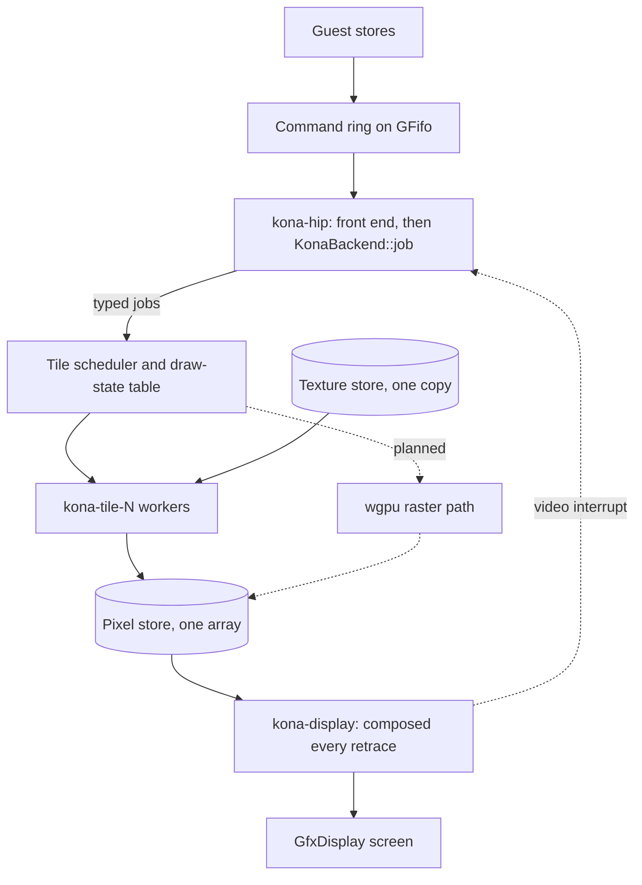
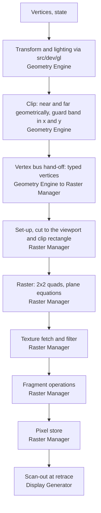

# Design: the InfiniteReality (KONA) board in Iris

Status: 2026-11-10. Built: the front end, the PROM console and the 4Dwm
desktop (within one level of their captures), GL triangles, lines and points
on the tile scheduler, texture, GL pixel operations, queries, select and
feedback, multisample, fog, texture generation, volume textures, the DAC
cursor and snapshots, with the GL demo frames pinned by replay. The Onyx2
deskside fits the board. Not done: stereo, the crosshair cursor, the DAC
cursor on channels past the first, and any check against hardware pixels. The
plan is
[onyx2-infinitereality.md](onyx2-infinitereality.md).

KONA is built on one branch and lands as one PR. Nothing here adds an
abstraction that isn't named: anything not named is private to its module.
Nothing I hold gives hardware pixels, so the whole model is an approximation
and no test claims pixel accuracy.

## Shape

The stages, with the board each one stands in for:

## Front end and attach

- **A concrete back end.** `KonaBackend` is a plain struct. The `Backend` trait
  and its null implementation go: there is one real implementation, and a trait
  needs two.
- **Attach.** `Kona` implements upstream's `BusDevice`, `Device` and
  `Resettable`, and takes an `InterruptController` and a `BusDevice` for host
  memory, the way VPro does. Each interrupt packet is one `set_line(vector,
  true)`; the board never clears, and the controller treats each `true` as
  "set pending bit". A test on the machine side holds the controller to that.
- **One lock.** `Mutex<Pipe>` guards the front end's stream state and the back
  end together. `kona-hip` takes it per batch of ring entries. CPU threads only
  `try_lock` it, for a waiting read, and answer busy if they can't get it or if
  the ring isn't empty. It is the one board lock held across memory and
  interrupt calls, and it can't deadlock because nothing that takes it is
  called back by the machine.
- **`defs`.** Every command selector, register offset, word index, bit field,
  GL enumerant and hardware count is a named constant in one `defs` module,
  transcribed from the board's published command table. No bare numbers in the
  rest of the code.
- **Reuse.** `src/dev/gl/` is used the way VPro uses it: KONA implements
  `ClipVertex` for its own vertex type and its own `Geometry`. Nothing in
  `src/dev/gl/`, MGRAS or VPro is edited.

## Back end

- **Token layer.** Plain data on `kona-hip`, in stream order. A table of
  contexts holds each one's X state, GL state and texture state. GL tokens
  dispatch through a table indexed by selector. The X integer path and the
  textport draw inline after a drain, onto the pixel store.
- **Geometry.** The board's projection puts clip z at (z-w)/2, so near and far
  are two plane distances, both clipped geometrically. x and y clip only at a
  guard band. Triangles then go to the raster with no window clip: set-up cuts
  each one to the viewport and the clip rectangle.
- **One snap.** The token layer truncates to the 1/256 grid once, set-up takes
  that to 1/8 exactly, and edges are exact integers with the fill rule decided
  by ties, so shared edges are watertight.
- **Typed hand-off.** A vertex carries window position, a depth fraction,
  colour, two sets of four texture words (s/w, t/w, r/w, q/w; zero if
  untextured) and a line distance. Colour is linear in screen space.
- **Draw-state table.** `DrawState` is a flat `Copy` record with no pointers:
  window, clip, viewport, ownership, targets, depth, stencil, alpha, blend,
  logic op, masks, stipples, fog and texture. State tokens mark it dirty; the
  next draw builds one record and puts it in the scheduler's table, and each
  job names it by index. A table entry is reused only after the last job
  naming it has retired.
- **Concrete tile scheduler.** Square tiles, one owner each, in KONA's own
  module, with a slot ring and per-tile queues. Every job goes to every tile its
  rectangle touches; workers keep the screen's 2x2 quad grid, so a tiled run is
  bit-exact with an inline one.
- **Per pixel.** Integer or reproducible `f32` arithmetic, with `f64` only in
  set-up, because WGSL has no `f64` and the stage must be portable to a GPU
  kernel. `WordArray::store` is the single write point. There is one
  per-fragment path that reads the draw state and branches on the enabled
  operations. Fast modes with const generics, as `ng1/rex3_generic.rs` does,
  wait for a fill-rate benchmark on a recorded stream to justify them.
- **Texture.** The texture arena is a member of the pixel store: one byte arena
  of one RM's capacity, zero-allocated and published once, with a bump
  allocator; an allocation past the end fails and is counted. Each context
  keeps a level map by bank and address, and a bind builds a flat `TexDesc`
  with no pointers. 1D and 2D sample; 3D and volume binds are counted, not
  drawn. The fourth texture word is q/w, so texture is perspective-correct.
  Only triangles sample.
- **Multisample.** 4 or 8 samples, chosen by the buffer layout. A pattern token
  picks one of seven patterns per count, each a pair of location words on the
  1/8 grid, and a sample mask indexes the coverage words. The first pattern is
  the default.
- **Window-ID ownership.** When the window-ID test is enabled, a fragment whose
  ID plane value fails the compare against the draw's reference and mask is
  dropped. A group-range ID passes on its group bits only, and a draw with the
  all-ones flag writes nothing. This is the rule between overlapping windows.
- **One pixel store.** Plane-major: one `u32` array per word of the pixel
  record, allocated whole at draw set-up and published through a fixed
  `AtomicPtr`, so workers and the display never check for allocation. Two
  8-bit ID planes sit beside it. Texture is one zero-allocated copy.
- **Display at retrace.** The display thread composes the whole frame every
  retrace from the pixel store and the loaded tables, with no change tracking.
  A swap takes effect when its command is reached in the stream: it loads the
  display's bank table, and the next composed frame shows it. A retrace request
  waits for the next frame boundary, tagged with the reset epoch it was made in
  so a reset drops it.

## Threads

| Thread | Does |
|---|---|
| CPU threads | `BusDevice` accesses: push to the ring, or answer from the register file |
| `kona-hip` | front end, token layer, replies, set-up, display-table loads |
| `kona-tile-N` | shades and stores the quads of the tiles it owns |
| `kona-display` | composes at retrace, latches swaps, drives the video interrupt |

Anything that must see drawing drains the scheduler first. The display waits for
nothing, and a guest sync fault shows as a flash of wrong pixels, as on the
board. Reset stops `kona-hip`, drains twice and clears the stores. A worker panic
poisons the scheduler and the board reports dead. Worker count and tile size
are the existing `[graphics] threads` and `tile` settings.

## Replay and goldens

I replay recordings from my QEMU model: the PROM, the 4Dwm desktop and the GL
demos. The driver performs the recorded stores and loads, feeds the recorded
DMA, and compares replies, interrupts and swap markers in order. The PROM and
4Dwm frames are held to no differing pixels against their captures; the GL demo
frames are pinned hashes. Recordings stay out of git. `KONA_RECORDINGS` and
`KONA_GL_RECORDING` name them, and the tests skip with a printed reason when
they're absent, so upstream CI doesn't run them. The golden scenes follow
VPro's: a small window per scene, planes hashed, bit-exact. Those hashes are
Iris's own, so they catch regressions and don't show correctness.

Benchmarks run with every function 64-byte aligned in both builds: fill rate per
fast mode against the generic kernel at 1, 2 and 4 workers, and a timed replay.
A CPU-benchmark regression from the board's presence fails the PR.

## Steps

All steps are on the one branch, each with its tests.

1. `defs` from the published command table.
2. Front end, pipe lock and attach through `InterruptController` and `BusDevice`.
3. Concrete back end; the drain rule; the PROM and 4Dwm replays.
4. Tile scheduler and draw-state table; tiled equals inline at 0, 1, 2 and 4 workers.
5. The geometry hand-off: near and far clipping, no window clip; GL goldens.
6. The Onyx2 machine instantiates the board (after the Onyx2 machine PR).
7. ID planes, overlays and cursors.
8. The per-pixel module and fragment operations, with the ownership test.
9. Lines, points and stipple.
10. Texture: arena, loads, binds, sampling.
11. GL pixel operations, queries, select and feedback; multisample.
12. Snapshots through the chunk store: a `Stream` visitor with a writer and a
    reader, chunks for the stores, the manifest change, and an atomic load that
    parses everything before it changes the live board.
13. IRIX on the Onyx2: 4Dwm and the GL demos without a pipe kill.

## Approximations

| Item | Grade | Test |
|---|---|---|
| Native token layer in place of the geometry engines and controller firmware | approximated | replay, then IRIX |
| Near and far clipped geometrically; x and y at a guard band | inferred | golden with a z-straddling triangle |
| Window position truncates toward minus infinity; one snap to 1/256, then 1/8 | unknown | golden, an edge on a grid line |
| Texture word carries q/w; colour linear in screen space | inferred, form unknown | goldens |
| Sample rule and positions; fill rule | approximated | goldens |
| Depth as an integer fraction | unknown | goldens |
| Fragment operation order, blend and dither arithmetic | unknown | goldens |
| Lines, points, stipple, texture filtering, format rounding | unknown | goldens |
| Retrace completes at the next frame boundary; swap applies in stream order | approximated | replay |
| One pixel store, one texture store, ID planes | unknown layout | allocation test |
| No credit count | decided | a large GL stream never trips a pipe kill |
| IR3 renders as IR2; IR4 identity only | approximated | `hinv`, visuals |

## Open

The set-up arithmetic can only be settled by measuring hardware. The display-ID
mode byte's fields are unknown, so some overlay and colour-index windows wait.
I don't know how wide a managed area can be past `GfxDisplay`'s stride.
