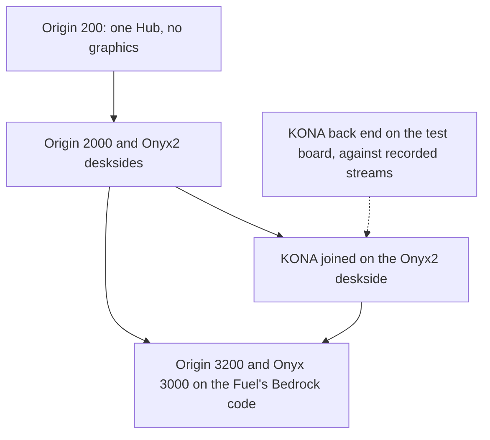

# Plan: the Onyx2, Onyx 3000 and InfiniteReality in Iris

Status: 2026-11-10. The Origin 200, Origin 2000 and Onyx2 (one and two
nodes) boot IRIX 6.5.30 to a login. The Onyx2 takes the InfiniteReality
pipe with `[graphics] board = "ir2"`, `"ir2:2rm"`, `"ir2e"` or `"ir2e:2rm"`,
and reaches the 4Dwm desktop. The PROM console and the desktop are within one
level of their captures, and the GL demo frames are pinned by replay. The
back end draws triangles, lines and points, textures (including volume
textures and detail), fog, pixel operations, queries, select and feedback,
multisample and the DAC cursor; its limits are in
[kona-back-end.md](kona-back-end.md) and `docs/graphics/kona.md`. The Origin
3200 and Onyx 3000 are not started. Snapshots of the IP27 machines are
refused, since the Hubs and node memory have no saved state.

## Goal

I want Iris to run the Origin 200, Origin 2000 and Onyx2 (IP27), and then the
Origin 3200 and Onyx 3000 (IP35), with the InfiniteReality pipe (KONA) on the
Onyx2 and Onyx 3400. The code is written the way current Iris is written, so
it can merge upstream without a restructure, and no CPU benchmark gets slower.

I port the IP27 platform and KONA's front end from QEMU's `sgi-origami`
branch. The drawing back end is new, built for Iris, because QEMU's is the same
shared-draw-path design that upstream already replaced in VPro.

## Order

1. **Origin 200.** One node, one Hub straight to the Bridge, no graphics.
   The Hub is ported from `hw/misc/sgi-hub.c`. The Bridge, IOC3 and Crossbow
   get small changes first (interrupt and DMA targets, a per-platform CPU
   limit), each with the Octane as its consumer, so the Hub PR stays small.
2. **Origin 2000 and Onyx2 desksides.** Two nodes over the Null Router
   (007-3453-002 pp. 21-22; Onyx2 007-3454-005 p. 19), four CPUs. The PROM
   brings a node's CPUs together by timing polls in retired instructions, so I
   reuse the Tezro starvation holds (the `tezro-mp-starvation` branch) at the
   Hub's registers.
3. **The InfiniteReality board**, joined to the Onyx2 deskside: PROM and
   `hinv`, console, 4Dwm, then the OpenGL demos QEMU runs today.
4. **Origin 3200 and Onyx 3000** on the Fuel's Bedrock code: two C-bricks
   (007-4311-002 p. 87), then the N-brick crossbar to a G-brick, then KONA.
   The rack and the Onyx 3400's four C-bricks come last.

Every machine gets a serial login first, on one CPU, from an IRIX disk made
under QEMU, unmodified (a copy-on-write overlay on a copy, never the
original). Graphics never waits for a booting machine: the back end is built
on the test board against streams recorded from QEMU's KONA, and joins a
machine at the Onyx2 join.

I compare the console and device access logs against QEMU on the same PROM and
disk and fix the first divergence. Unmodelled accesses stay visible through
`devlog`; nothing is answered with a made-up success.

## Decisions

- KONA is one implementation branch and lands as one PR, stacked on the SN0
  machine PRs it joins. Iris leads the board. I build the back end here and port it back to QEMU
  afterwards. The platform parts still port from QEMU.
- Graphics credits are not counted. Iris keeps the register values IRIX writes;
  the FIFO level, the FIFO-low interrupt and `GFifo`'s busy answer are the only
  throttle. VPro already works this way. When `PiGfx` leaves
  `src/dev/odyssey/` for the Hub, the test-only credit paths go with it.
- KONA's board state saves and restores through the chunk store. The Octane
  refuses a save with IMPACT, VPro or two CPUs, and the IP27 machines refuse
  with a reason too, until multi-CPU IP27 and IP35 state round-trip.
- The KONA model is an approximation. Success is stock software behaving and
  the model agreeing with itself. Nothing I hold gives hardware pixels.
- Out of scope: the Mesa provider, more than one pipe.

## Done when

1. The Origin 200, the Origin 2000 deskside (two nodes, four CPUs) and the
   Onyx2 deskside (two nodes) boot IRIX 6.5.30 to a serial login.
2. The Origin 3200 with two C-bricks boots IRIX to a serial login.
3. IRIX 6.5.30 installs in Iris on the Onyx2 deskside and the installed disk
   boots to a serial login.
4. The Onyx2 deskside with InfiniteReality2 on one RM reaches 4Dwm, and
   atlantis, ivview and the textured-cube demo run without a pipe kill or FIFO
   fault. Their recorded streams replay cleanly.
5. KONA's state and the multi-CPU IP27 machine round-trip through a snapshot.
6. Every branch passes `cargo test --workspace` and the performance rule.

## Rules for every PR

- No new branch, lookup or lock on a per-access, per-instruction or per-pixel
  path. Measure with every function 64-byte aligned in both builds. A dip that
  survives equal alignment is a bug. CPU and platform PRs run `iris-bench`;
  KONA PRs replay a recorded 4Dwm-plus-GL stream and a fill-rate benchmark.
- Tests run under plain `cargo test` on `TestBoard`, free their device maps
  (`MAX_MAPS` stays 64), retry on `BUS_BUSY` and never wait on the wall clock.
- A file ported from QEMU keeps `Ported from hw/... in jamesbraid/qemu-sgi-origami`.
  Files that aren't ports say "Designed for Iris".
- Use published names only: SGI's manuals by number and page, the 1997
  SIGGRAPH InfiniteReality paper, Kilgard's 1997 paper and SGI's 1998 Onyx2
  technical report. Describe registers by role. No names or numbers taken from
  IRIX or unpublished sources.
- One commit per logical change, fixups folded in.
