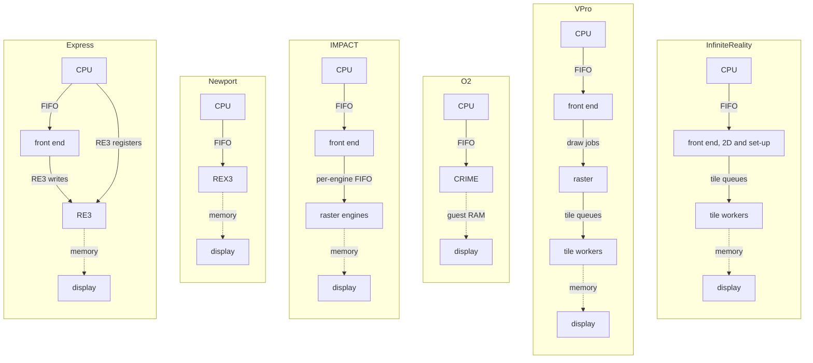

# Graphics boards

An SGI graphics board turns drawing commands from the CPU into a picture on a
monitor. The CPU writes commands into a FIFO on the board, and the board works
through them at its own pace. Software polls FIFO levels and status registers
to stay in step. Iris keeps the FIFO and the polling. It does not model how fast the board draws, but it keeps retrace and a few bounded waits. The board's work runs on host threads.

Each board has its own page. This one explains the pipeline they all
implement, compares them, and describes the structure they share.

| Board | Machines | Page |
|---|---|---|
| Express (GR2) | Indy XZ; Indigo2 XZ, Elan and Extreme; Indigo XS, XS24, XZ and Elan | [gr2.md](gr2.md) |
| Newport (REX3) | Indy, Indigo2 XL | [newport.md](newport.md) |
| IMPACT (MGRAS) | Indigo2 IMPACT, Octane | [mgras.md](mgras.md) |
| O2 graphics (CRIME, GBE) | O2 | [o2.md](o2.md) |
| VPro (Odyssey) | Octane | [vpro.md](vpro.md) |
| InfiniteReality (KONA) | Onyx, Onyx2, Onyx 300 and Onyx 350 (Onyx2 only, with `[graphics] board`; see the [Onyx2 guide](../onyx2-ip27.md)) | [kona.md](kona.md) |

The Machines column lists the machines each board shipped in. Iris accepts some boards on more machine profiles than the column shows; `GraphicsBoard::supports` in `src/config.rs` lists them.

## The graphics pipeline

A 3D application describes a scene as primitives (points, lines and
triangles), each given by its vertices. Drawing one takes these stages on each board. The board diagrams show clipping and leave out a separate viewport-mapping box:

1. **Transform and lighting.** Each vertex is moved from the model's own
   coordinates into the viewer's, and its colour is worked out from the lights
   and the material. A projection then maps it into clip coordinates, where the
   visible volume is a fixed box.
2. **Clipping.** Primitives are cut against that box, so nothing outside the
   window or behind the viewer goes further.
3. **Viewport mapping.** Surviving vertices are divided through by their depth
   term and scaled to pixel positions in the window.
4. **Set-up.** A triangle's three vertices become the edge equations and
   per-pixel steps the rasteriser needs.
5. **Rasterisation.** The rasteriser finds the pixels the primitive covers and
   makes a *fragment* for each: a candidate pixel with its depth, colour and
   texture coordinates.
6. **Shading and texture.** Each fragment's colour is interpolated across the
   primitive, and texture is looked up and filtered.
7. **Per-fragment operations.** The depth, stencil and alpha tests decide
   whether the fragment is kept. Blending and logic ops combine it with the
   pixel already there.
8. **Frame buffer.** Kept fragments are written to board memory.
9. **Scan-out.** The display hardware reads the frame buffer at each refresh,
   passes it through colour maps and gamma, and drives the monitor.

Stages 1 to 3 are geometry, 4 to 8 are raster and 9 is display. The board pages name each board's own unit for a stage.

Boards differ in where their hardware starts. Newport and the O2 leave geometry to the workstation's CPU and start at rasterisation. Express, IMPACT, VPro and InfiniteReality do geometry in hardware, so the CPU sends only commands and vertices.

### 2D drawing

Not everything goes through the 3D pipeline. The PROM's text console and the
X server draw in 2D: rectangle fills, lines, glyphs, screen-to-screen copies
and pixel reads and writes. These have no vertices to transform or clip, so
they start at rasterisation and use only the later stages: the per-fragment
operations (logic ops, write masks, clipping to the window) and the frame
buffer. Each board takes them as commands of their own, separate from
3D primitives.

## What the hardware does

The chip that does each stage on the real board. VPro's chips are named as published: the front-end ASIC, OpenGL on a Chip (Buzz), and the back-end ASIC, Pixel Blaster & Jammer. "CPU" means the graphics
library does the stage in software on the workstation's processor.

| Stage | Express | Newport | IMPACT | O2 | VPro | InfiniteReality |
|---|---|---|---|---|---|---|
| Transform and lighting | GE7 | CPU | GE11 | CPU | VPro front end (Buzz) | Geometry Engines |
| Clipping and viewport mapping | GE7 (inferred) | CPU | GE11 | CPU | VPro front end (Buzz) | Geometry Engines |
| Set-up | GE7 (hand-off not documented) | CPU | RE4 (slopes not documented) | CPU (plane-equation parameters) | VPro front end (Buzz) | Fragment Generator, in each Raster Manager |
| Rasterisation | RE3 | REX3 | RE4 | CRIME (rendering engine) | VPro front end (Buzz) | Fragment Generator, in each Raster Manager |
| Shading and texture | RE3, no texture | REX3, no texture | RE4, TE1 and TRAM | CRIME (rendering engine) | VPro front end (Buzz) | Fragment Generator, with texture memory and fog |
| Per-fragment operations | RE3 (blending not documented) | REX3, no hardware depth | PP1 (fog in RE4) | CRIME (rendering engine) | VPro front end (Buzz) | Image Engines (alpha test in the Fragment Generator) |
| Frame buffer | Video memory boards and a Z-buffer board (memory type not documented) | VRAM | RDRAM, 12 MB per raster engine, behind its PP1s | main RAM, in 64 KB tiles | board SDRAM, shared with textures and the command FIFO | Image Engines, one 256K x 32 SDRAM each |
| Scan-out | XMAP5, Bt457; VC1 timing (inferred) | RO1, XMAP9, CMAP, Bt445; VC2 timing | CMAP, VIO1 and RAMDAC; VC3 timing (inferred) | GBE | Pixel Blaster & Jammer | Display Generator |

## What Iris does

Iris does not run any board's geometry microcode. Where a board has geometry
hardware, Iris does that stage in Rust at the level of the board's own command or token stream, using the shared GL core in `src/dev/gl/`. On VPro it does this by recognising the uploaded vertex programs. Where the CPU did the stage, Iris does
nothing: the guest's own library code runs as ordinary guest code.

| Stage | Express | Newport | IMPACT | O2 | VPro | InfiniteReality |
|---|---|---|---|---|---|---|
| Geometry (stages 1-3) | shared GL core | guest | shared GL core | guest | shared GL core | shared GL core |
| Rasterisation and shading | span interpreter, optional span JIT | shader table chosen per draw, optional JIT | interpreter or JIT, one thread per raster engine | plain Rust | tile workers, or the host GPU | integer 2D loops on the front end; tile workers for GL |
| Frame buffer | word arrays | word arrays | per-engine pages | guest RAM | one word array, or a GPU buffer | one pixel store |
| Scan-out | display thread | display thread | display thread | display thread | display thread, or the host GPU | display thread |

### 2D drawing in Iris

Each board's 2D commands run on its command thread, or on the front-end thread
where the board has one. The board pages say which. What the hardware does with
these commands is inferred from public documents for Newport, the O2 and IMPACT,
and not publicly documented for Express, VPro and InfiniteReality.

## Threads

Boards split the work into one to three threads after the CPU. The CPU thread writes drawing commands to the FIFO, and a few registers act on the CPU thread directly (O2 GBE, Newport CONFIG and DCB). Newport and O2 have one command-and-draw thread. Express and IMPACT split decode from raster, and VPro splits it twice. InfiniteReality splits it once, into tile workers. A display thread reads the frame buffer at each refresh and presents it.

Solid arrows are queues. Dotted arrows are reads of board memory, mostly unlocked.

## What the boards share

- **The FIFO** is a `GFifo` (`src/gfifo.rs`). When the host ring is full, the bus answers `BUS_BUSY` and the CPU retries the store. This stands in for the hardware's flow control; where the real board stalls is not modelled.
- **Each stage's thread owns its state.** Other threads touch it only when the queues in front are idle. No lock covers the whole board; individual registers and snapshots have their own.
- **Reads that depend on queued work wait** until the queues drain. Registers
  the driver polls while the board works, such as status and FIFO level, answer at once, except that an IMPACT status poll waits up to 100 us for a busy board.
- **The display thread reads the frame buffer without a lock.** It takes locks on the tables it copies and on the screen it publishes. Scan-out reads the frame buffer independently of drawing, so a pixel written during a refresh can appear in that frame or the next. Iris tolerates this. That the hardware does not synchronise the two is inferred.
- **`GfxDisplay`** (`src/gfx_display.rs`) is how the window, VNC and screenshots see the boards.
- **Each board has a monitor command** to show state, read pixels and take screenshots. Newport, IMPACT, VPro and O2 have a recorder for command streams, which lets them be tested without a guest. Express has no recorder; it replays captured HQ2 traces.

## Adding a board

The newer boards follow this pattern. It is not a rule.

1. Put command stores in a `GFifo`, and answer `BUS_BUSY` when it is full.
2. Run the commands on one thread.
3. Serve polled registers immediately. Make reads that depend on queued work
   wait for the queue.
4. Hand work to the raster stage the way the hardware does: register writes if
   the hardware has a register interface there, typed jobs if it does not.
5. Keep board memory behind one accessor.
6. Compose on a display thread that reads memory without locking.
7. Implement `GfxDisplay`.
8. Add a recorded-stream replay test.
