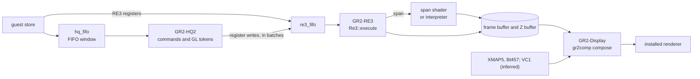
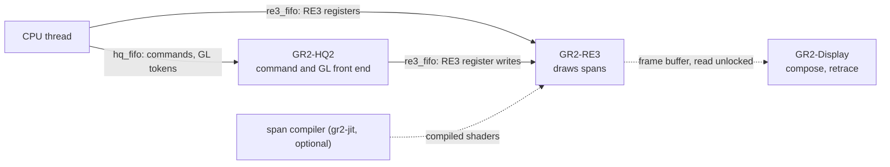

# Express (GR2)

Source: `src/dev/gr2/`. Part of [Graphics boards](README.md).
Paths are relative to that directory unless they start with another one.

The machines these boards ship in, and how to select them, are in
[GR2 XZ and Extreme graphics](gr2-xz-extreme.md).

Express (GR2) is the graphics board of the Indy XZ, the Indigo2 XZ, the Indigo2 Elan and the Indigo2 Extreme. Iris models the XZ and the Extreme (the `Xz` and `Extreme` graphics boards in `src/config.rs`); there is no Elan setting.
The XZ carries two geometry engines (GE7), the Elan four and the Extreme eight (inferred from the published counts; `Gr2Variant::ges`). The board has four parts: the HQ2 command engine, the GE7
geometry engines, the RE3 raster engine with its frame buffer, and the display tables
(XMAP5 colour maps and a Bt457 RAMDAC; VC1 timing is inferred). The HQ2 and GE7 microcode is stored and read back but
never run. The model does the work of the microcode in Rust, at the level of the
GL call, and keeps the register interface the guest drives.

The guest's stores go into two rings. The HQ2 ring carries commands and GL tokens.
The RE3 ring carries register writes for the raster engine. The HQ2 thread turns
its commands into RE3 writes. The RE3 thread draws. A display thread composes
the frame buffer about 60 times a second.

## The pipeline

On this board the geometry engines do all the per-vertex work, and RE3 does the per-pixel work. How the two hand off is not publicly documented. No Express board has hardware texturing; OpenGL textures are drawn in software on the workstation's CPU. The model has no texture unit, and textured primitives arrive as software spans from the GL library.

```mermaid
flowchart LR
  A["<b>Transform and lighting</b><br/>Hardware: GE7<br/>Iris: shared GL core, driven from gr2/gl.rs<br/>on GR2-HQ2"]
  B["<b>Clipping</b><br/>Hardware: GE7 (inferred)<br/>Iris: shared GL core, then polygon clipping<br/>and window clipping in gr2/gl.rs"]
  C["<b>Set-up</b><br/>Hardware: hand-off format to RE3 not documented<br/>Iris: gr2/gl.rs writes RE3 span registers"]
  D["<b>Rasterisation</b><br/>Hardware: RE3 draws; hand-off not documented<br/>Iris: GR2-RE3, interpreter or span JIT"]
  E["<b>Shading and texture</b><br/>Hardware: colour stepping not documented.<br/>No texture on this board<br/>Iris: same span routine"]
  G["<b>Per-fragment operations</b><br/>Hardware: per-pixel list not documented;<br/>blending and alpha test not documented<br/>Iris: same span routine; RE3 pattern, window-ID, Z,<br/>stencil and logic op; Iris blends in the span routine"]
  H[("<b>Frame buffer</b><br/>Hardware: video memory boards and a Z-buffer board<br/>(type not documented)<br/>Iris: one word per pixel, in Re3")]
  I["<b>Scan-out</b><br/>Hardware: XMAP5, Bt457; VC1 timing (inferred)<br/>Iris: GR2-Display, gr2comp"]
  A --> B --> C --> D --> E --> G --> H --> I
```

## Data flow

## From a store to the raster engine

A store into the FIFO window (`0x40000` to `0x60000`) becomes an HQ2 entry with
the word index as its address. A full FIFO returns `BUS_BUSY`, and the CPU retries
the store.

Stores to the RE3 registers (`0x6c200` to `0x6c300`, and `0x6c600` to `0x6c604`)
skip the HQ2 thread. They go straight onto `re3_fifo` (`re3_write`).

The HQ2 read port (`0x6a068`) takes DMA data and answers `BUS_BUSY` while the HQ2
works and has nothing to give.

The HQ2 thread (`hq_loop`) takes entries from `hq_fifo` in order. Textport
commands run through `Hq2Engine::execute` (`hq2.rs`). GL tokens run through
`gl_execute` (`gl.rs`). Both turn their work into RE3 register writes, which are
staged and pushed in batches.

The GL side (`gl.rs`, `gl_light.rs`) keeps the GL state, assembles primitives,
transforms and clips them through the shared GL core (`src/dev/gl/`), and emits
RE3 spans. Iris blends in its RE3 span routine (`RE3_OP_BLEND`, `RE3_OP_ALPHA`). Where the real board blends is not documented. The board has no alpha test. The guest's GL library rasterizes alpha-tested primitives on the CPU and sends the surviving fragments, which Iris draws through `gl_fragment`.

The RE3 thread (`re3_loop`) applies register writes in order. An IR write runs
`Re3::execute` (`re3.rs`). The span kinds are SHADED (`draw_shaded_span`) and
FLAT or FLAT4 (`draw_flat_span`), which step the colour at an Iris-chosen interval (5 pixels for FLAT, 20 for FLAT4).

## 2D drawing

The `HQ2_2D_*` commands (`gr2/hq2.rs`) run on the GR2-HQ2 thread, which turns
them into RE3 span writes. GR2-RE3 draws the spans. What the real board does
with these commands is not publicly documented.

## Threads

- **GR2-HQ2.** Runs the HQ2 commands and GL state.
- **GR2-RE3.** Applies register writes and draws spans into the frame buffer and the Z
  buffer.
- **GR2-Display** (`display_loop` in `gr2disp.rs`). Retrace, composition and
  presentation.
- **Span compiler** (`re3_jit/`). Built only with `gr2-jit`.

The display thread reads the frame buffer with no lock. Tearing is tolerated.

## Where drawing happens

The interpreter is the reference. `draw_shaded_span` runs each pixel in order:
clip, pattern, window-ID test, Z and stencil tests, colour with blend, then store.
The file header calls it generic and unoptimised.

The span JIT (`re3_jit/`) compiles the same pipeline per shape. It is not in the
default build: `gr2-jit` is a separate feature. The mode comes from `IRIS_GR2_JIT`
(`off`, `sync` or `async`; `0`, `1` and `on` also work). It defaults to `async`, and `off` in unit tests.
`IRIS_NO_JIT` forces it off.

- The key is `SpanKey` (`re3_jit/key.rs`). It names the instruction (SHADED, FLAT
  or FLAT4), the pixel format and dither, the raster op, the pattern mode, the WID
  test, and for SHADED spans the depth, stencil and blend. Fields that cannot change
  the result are zeroed, so equivalent configurations share one shader.
- `run` looks the key up. A hit calls the shader, which takes the `Re3` as its only
  argument and reads its registers and iterators at fixed offsets. A miss runs the
  span in the interpreter, and the compile is queued.
- Shaders are compiled on one background thread into a store shared by all boards.
  The shader emitters are named after the interpreter routines they mirror.
- A memoised shader is dropped only when a register that shapes the key changes
  (`shapes_key`), or when a pixel-format, Z or stencil or blend setter is called.
- The tests in `re3_jit_tests.rs` compare the shaders with the interpreter over the keys they cover and over whole boards.

## Board memory and scan-out

The frame buffer is one `u32` per pixel, 1280 x 1024. A pixel is
`cid[31:28] | aux[27:24] | rgb/ci[23:0]`. Rows are stored bottom-up, so y = 0 is
the bottom scanline. The Z buffer has the same shape. Both arrays sit in `Re3`,
which the board builds on the heap, because they are several megabytes.

GL pixel copies go through the read and write buffer paths (`read_buffer`,
`write_buffer`, `copy_rect_gl`).

Composition is in `gr2comp.rs`. It builds a 1280 x 1024 frame in the same
`0xAABBGGRR` format the software compositor makes. Priority runs from the top: the
cursor, the popup and overlay planes (aux bits 3:2 and 1:0), the main visual
chosen by the XMAP5 mode word, then blackout. The Bt457 read mask and gamma ramp
are applied last. The code comments say several of these details are not checked
against the hardware.

## Display and presentation

`display_loop` runs at 60 Hz. It composes when the picture changed, or once per
idle interval so the status bar keeps moving. It presents the frame through the
installed renderer, then pulses the retrace line. A flip that the guest makes
during blanking shows from the next frame.

On the machine side the retrace is GIO interrupt 2. The header of `gr2disp.rs` says
the IOC latches the retrace until the host acknowledges it. The register code here does not confirm that.

The board reports a plain 60 Hz 1280 x 1024 monitor, chosen to avoid monitor IDs
with special handling (`MONITOR_ID`).

## Monitor commands

- `gr2 status`, `gr2 hq`, `gr2 ge`, `gr2 shram`, `gr2 ucode`, `gr2 vc1[sram]`,
  `gr2 xmap`, `gr2 clut`, `gr2 dac`, `gr2 pix`, `gr2 fbdump`
- `gr2 jit on|off|sync|list` (only in a build with `gr2-jit`)
- `gr2 trace <file> [hq|re3|cpu|all]` (categories combine, as in `hq,cpu`),
  `gr2 trace off|flush` (starting a trace needs a build with `gputrace`, which
  `developer` turns on)
- `re3 [regs]`, `re3 pix <x> <y> [w] [h]`

The dispatch is in `debug.rs`. The trace writes text lines from both threads.
Tracing slows the pipeline, as the header says.

## Tests and benchmarks

- `hq2_tests.rs`: tests of the HQ2 and GL path. Some replay captured HQ2 FIFO
  streams from `testdata/glprim_*.trace`. `bench_gl_smooth_triangles` is an
  ignored benchmark. `gr2_replay_file` is an ignored tool that replays a HQ2
  stream from `$GR2_REPLAY` and dumps the frame buffer.
- `re3_tests.rs`: tests of the raster engine.
- `re3_jit_tests.rs`: tests of the span JIT, with the ignored benchmark
  `bench_interpreter_vs_jit`.
- Smaller sets sit beside the code: `re3_jit/key.rs`, `gr2comp.rs`, `gl_light.rs`.
- There is no recorder. The HQ2 streams are the captured input, and `gr2 trace`
  gives text lines.
- `clanker/gr2/gl-test-suites.md` lists board-neutral GL suites that run on the
  XZ. Its results are not re-run here (unverified).

The design notes are in `clanker/gr2/` (`DESIGN.md`, `re3-jit.md`, and notes on
GL state, clipping and the FIFO).
