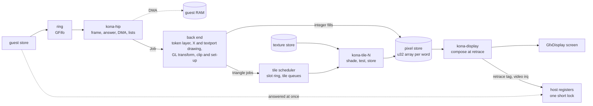
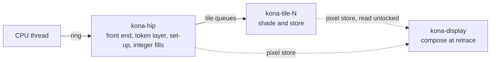

# InfiniteReality (KONA)

Source: `src/dev/kona/`. Part of [Graphics boards](README.md).

InfiniteReality is the graphics pipe of Onyx and Onyx2 (later Onyx 300 and Onyx 350 as InfiniteReality3/4). Iris models an InfiniteReality2 or InfiniteReality2E pipe with one or two Raster Managers, fitted in the graphics slot of the [Onyx2 deskside](../onyx2-ip27.md). The pipe's window is the machine's display. No other machine takes the board. The product table also holds an InfiniteReality3, which shipped in other chassis than the deskside, so no machine fits it and it has no board name yet.

The pipe is a crosstalk widget. The processor stores commands to one command page, in one of three grammars that share the page: the PROM's textport, the kernel and X server's commands, and the GL client's. A Host Interface Processor takes the words, answers the commands about the board itself (identity, configuration, flash, DMA, display lists) and passes everything that draws or changes display state on. The Geometry Distributor, Geometry Engines, Raster Managers and Display Generator behind it are the back end.

The back end draws the PROM's console, the X server's fills, pixel moves and stipples, and the GL client's triangles, lines, points, pixel operations and textures, and it composes the desktop display. Nothing available gives hardware pixels, so the whole back end is an approximation and no test claims pixel accuracy. Input the back end does not take is counted per kind, shown by the `kona` monitor commands and logged. Nothing is answered with a made-up success.

## The pipeline

On the real pipe the Geometry Engines transform, light and clip. Each Raster Manager (one, two or four per pipe) has one Fragment Generator, which sets triangles up from screen-space vertices, scan-converts, computes texture addresses, filters texels, applies fog and does the alpha test. Its Image Engines do the per-fragment operations and hold the frame buffer. The Display Generator reads the pixels out.

Iris runs transform, lighting, clipping and set-up on the front-end thread, the per-pixel stages on tile workers and scan-out on a display thread. Fog and smoothing are applied by the model's own rules, not the board's.

```mermaid
flowchart LR
  A["<b>Transform and lighting</b><br/>Hardware: Geometry Engines<br/>Iris: shared GL core, on kona-hip"]
  B["<b>Clipping</b><br/>Hardware: Geometry Engines<br/>Iris: shared GL core; near and far planes,<br/>user clip planes,<br/>x and y only at a guard band"]
  C["<b>Set-up</b><br/>Hardware: Fragment Generator, from screen-space vertices<br/>Iris: on kona-hip; 1/8 pixel grid, exact integer edges,<br/>cut to the scissor and viewport"]
  D["<b>Rasterisation</b><br/>Hardware: Fragment Generator, scan conversion<br/>Iris: kona-tile-N workers, in 2x2 quads"]
  E["<b>Shading and texture</b><br/>Hardware: Fragment Generator, texture<br/>addressing, filtering, fog, alpha test<br/>Iris: tile workers; fog and smoothing by the model's rules"]
  G["<b>Per-fragment operations</b><br/>Hardware: Image Engines<br/>Iris: tile workers"]
  H[("<b>Frame buffer</b><br/>Hardware: Image Engines, one 256K x 32 SDRAM each<br/>Iris: one u32 array per pixel word")]
  I["<b>Scan-out</b><br/>Hardware: Display Generator<br/>Iris: kona-display composes at retrace"]
  A --> B --> C --> D --> E --> G --> H --> I
```



### 2D drawing

The textport and the X server's integer fills, pixel moves and stipples do not go through the transform, clip or set-up stages. They run on the `kona-hip` front-end thread, after the tile workers have drained, straight into the pixel store. What the board does with these commands is not publicly documented.

- **The textport** sets a colour index, plots points, fills boxes, draws bitmaps and loads the textport's colour map. A pixel is a colour index, resolved at scan-out. The placement of a bitmap is the model's reading of the glyph routines that send it.
- **The X server** loads a graphics context, a drawable position, a clip list, a scissor and a stipple cache for each rendering context, and each context keeps its own copy. Boxes, rectangles, spans and points draw under that state into the main planes, the overlay and popup planes or the display-ID plane, clipped and masked by the stipple. Background points draw in the context's background colour and are not stippled. Pixel writes, reads and copies are taken too. Relative points step from the previous point, the first from the drawable's origin, and every other point and line vertex, absolute or relative, is added to the drawable's position: the senders do not zero it (the X server loads the drawable's screen position, and 386 of the 1192 position loads in the desktop recording are nonzero), the recorded loads are established and the add is inferred. A polyline arrives as n - 1 words of data preload and a one-word token (the sender counts, established; the pipe's consumption, inferred). Line segments and polylines are approximated: the segment token's drawing is unknown and the polylines' is inferred (a polyline of n points makes n - 1 segments with no implicit close), and the engine's line drawer is not decoded to the pixels it lights. The model draws both ends, a segment of no length as one pixel, and a vertex shared by two segments once, under the same state and clip, with the line through pixel centres and a tie going to the pixel nearer the end point. None of those four choices is read from a source, including the one-pixel segment of no length, whose cited evidence is a zero-width line. Whether a polyline's last vertex or a closing vertex is drawn once or twice is not known.
- **Boxes** light the columns and rows the fill rule gives: for corners `x1 < x2`, columns `x1 + 1` to `x2`. The X server's rows run down from the top of the screen and the textport's up from the bottom. The store is bottom-origin and the display flips it once.

## Data flow

The processor's stores go into a ring and the processor goes on. `kona-hip` takes the stores in order, frames each word into a command, handles what is the board's own and hands the rest to the back end as a typed job. Registers the driver polls while the pipe works are served at once from a register file.



The machine gives the board an `InterruptController`, a `BusDevice` for host memory, the status-bar source and, optionally, a flash file. The board names no Hub or Bridge type. Each interrupt packet is one `set_line(vector, true)`: it sets the vector's pending bit, and the board never clears one. A full ring answers the bus busy and the processor retries the store. Graphics credits are not counted.

`Shared::pipe`, a mutex over the front end's state and the back end, is held by `kona-hip` for each batch of stores, across calls to the machine's memory and interrupt controller. That cannot deadlock, because the machine never calls back into the board. A processor access only `try_lock`s it, for a read that has to wait for the stream, and answers busy when it is out. The register file has its own short lock, never held across a call out of the board.

The front end frames words with tables of the command selectors and drops words the tables lack. Every selector, register offset, word index and bit field is a named constant in `defs.rs`. The back end keeps each rendering context's X state, GL state and texture state together, and the front end names the current context with every job.

Pixel memory is one `u32` array per word of a pixel's record. The record holds up to 64 words, laid out by the window's buffer configuration (`back/store/layout.rs`): colour buffers, depth, 8-bit stencil, multisample colour and accumulation, in that order. Each array is the size of the managed area, allocated whole at a draw's set-up and published through a fixed atomic pointer, so a worker or the display never checks for allocation. A fill that touches one word writes contiguous memory, and a window that uses 13 words allocates 13 arrays. The elements are relaxed atomics, so a display read that races a write is defined and costs a plain load. Four planes sit beside the record: the display-ID plane, overlay 0, overlay 1 and the popup. Texture memory is a separate store of one 32-bit word per texel, sized as one Raster Manager's texture memory. Which physical memory holds a pixel is unknown, and the function from (pixel, word) to storage is behind one method (`word_slot`).

Not modelled: which Raster Manager holds a pixel, raster-bus words and flow-control credits.

## Threads



`kona-hip` runs the front end, the token layer and set-up. A draw's set-up goes into the next slot of a ring, and the slot's index goes on the queue of every screen tile the draw can touch. A `kona-tile-N` worker takes a ready tile and owns it until its queue is empty, so every pixel sees its work in command order. `[graphics] threads` sets the worker count (default 2) and `[graphics] tile` the tile size in pixels (default 32). A work budget in estimated pixels stops `kona-hip` running far ahead of the workers. A panic in a worker poisons the scheduler, and the board reports itself dead.

Anything that reads or writes pixels outside the workers, such as an integer fill, a pixel read, a swap or a retrace request, drains the tiles first. The display thread waits for nothing and reads the store without a lock. It composes the whole frame at 60 Hz with no change tracking. At each frame boundary it completes the retrace requests made since the last one and raises the video interrupt, through a handle to the register file. A reset begins a new epoch, so a call from a previous one is dropped.

## The display generator's channels

The X server describes the screen to the display generator with video commands: it loads a video format into each of eight channels, says which rectangle of the managed area a channel shows, and enables or blanks it. The back end keeps what those setters leave behind (`back/display/channels.rs`), answers the Gets from it on the return page, and, when the loader releases the firmware, runs the video combination stored in the flash or the built-in one. The state is part of the snapshot. Gets answer from the model's state; no reply was measured from a pipe.

Blanking blacks the frame when it blanks channel 0 (the one the board shows) or, as a temporary blank, every channel; the pixel store is untouched and the picture returns when the blank ends. Other channels' blanking is kept (`kona status` lists the channels blanked, and each change is logged). Kept and not acted on: a managed size other than the configured one (a combination that names another is logged and the configured size is what the board reports), a channel taking another's timing (Vampire), a channel bound to an X window, and the timing words of a loaded format. The board shows one channel's worth of pixels at the managed size, 1280 x 1024 to begin with.

## From a GL token to pixels

The pipe, not the guest's graphics library, keeps the matrices, lights and material. The GL client's state commands update the rendering context's state. A begin opens a primitive, vertex commands transform, light and assemble it, and an end closes it. Commands the model does not take (the colour-index double form and vertex arrays among them) are counted by selector and shown by `kona status`.

### Geometry

- **Assembly.** Triangles, strips, fans, quads, quad strips and polygons are broken into independent triangles, a polygon of more than three vertices into one fan from its first. That the engines split polygons this way is inferred. Flat shading takes the colour of the vertex GL names. Two-sided lighting and culling use the polygon's projected orientation.
- **Polygon modes.** The polygon fill mode command carries two words, the face then the mode (established). The pipe checks neither: a face other than front, back or both is ignored without an error, and a mode word is kept as sent. A triangle reads its face's mode as line when it equals GL's line mode, as point when below it and as fill when above (established), and the model does the same. The pipe also writes a line-mode flag from each call's mode alone; the model keeps no such flag. A face in the line mode is drawn, after clipping and culling, as lines between the vertices whose edge flag is set, and one in the point mode as points at them. They take the line width and stipple or the point size, and the face's own colours, not the polygon stipple, and they are smoothed by the polygon-smooth switch and not the line or point one (inferred). A triangle's and a polygon's edges come from the per-vertex edge flags (inferred). A quad strip's pieces get a constant flag word whatever the flags, so the user's edge flags do not reach them (the constant is established, its meaning inferred); the model draws a quad's four sides. Which edges of a triangle strip or fan draw is unknown, and the model draws every edge of each piece. The pipe applies polygon offset to a polygon drawn as lines or points, under an enable of its own for each mode, and never to a line or point primitive (established); the model keeps no enables for the two modes and applies no offset to them, a limit.
- **Clipping.** The shared GL core clips in clip space (`src/dev/gl/`, with `KonaGeometry` in `back/gl/vertex.rs`). Near and far are clipped geometrically against two planes. x and y are cut only at a guard band eight clip widths out from the centre, which keeps window positions inside an `i32` grid. Which exact depth range the engines cut is unconfirmed. Nothing clips in window space.
- **User clip planes.** `glClipPlane` arrives as a plane name and four doubles (nine words) and the plane's enable through the generic enable token, which takes only the six names 0x3000 to 0x3005 and refuses the rest of 0x3000 to 0x3fff as an invalid enumerant; the framing, the names and the query that reads a plane back are established. The double narrowing to single precision first is inferred. The model keeps the plane in eye space, the coefficients times the full 4x4 inverse of the model-view matrix at the call. That the pipe does that is inferred; a matrix with no inverse is an unknown, and the model leaves the plane unchanged. A vertex is tested against the six view-volume planes and the enabled user planes together, as the core's planes 0 to 11, for triangles, lines and points. A primitive's begin copies the planes and enables into the clipper once, so a vertex takes no new branch.
- **Texture-coordinate generation.** The one token (nine words: a coordinate, a parameter name, seven value words) and the per-coordinate enables are established. Its modes are object linear, eye linear (the start-up mode, established) and, for s and t only, sphere map. The equations are OpenGL's, in `src/dev/gl/texgen.rs`, and are inferred: no source states the arithmetic. Eye planes are stored in eye space like clip planes. A generated coordinate replaces the current one before the texture matrix, and only while texturing is on. A begin decides once whether anything is generated and whether that needs the normal. The pipe accepts the coordinates 0x2000 to 0x2003, the names 0x2500 to 0x2502 and 0x81f4 to 0x81f7 and the modes 0x2400 to 0x2402 and 0x81f0 to 0x81f3, and refuses any other value (established). The point and line distance planes and modes are accepted, counted and change nothing. Sphere map on r or q is not refused, and the engine appears to ignore it (inferred): the model keeps the mode and leaves the coordinate. The eye plane is stored times the inverse model-view, the object plane as sent; start-up is OpenGL's (s = (1,0,0,0), t = (0,1,0,0), r and q zero, eye linear).
- **Double forms.** The double colour, normal, texture-coordinate and vertex tokens are narrowed to single precision as the command arrives, high word first, and run the float forms' path. The texture-coordinate forms are established and the others inferred. The colour-index double form stays unmodelled; the model has no colour-index mode.
- **The hand-off.** A vertex leaves the geometry stage as a window position, a 32-bit depth fraction, four 13-bit colour components and two sets of four texture words (`s/w`, `t/w`, `r/w`, `q/w`; zero when untextured). That a textured vertex carries a fourth word is inferred, and so is its form; the model uses `q/w`.
- **One snap.** A window position is rounded to the nearest 1/256 pixel, ties to even, once. This stands in for the geometry engine's subtract of 49152.0 putting the position on that grid. The rounding mode is inferred.

### Set-up and the sample rule

Set-up runs once for each triangle, on `kona-hip`. It takes the GL half-pixel offset off x and y, rounds to the nearest 1/8 pixel with ties up, and adds the window's origin in whole pixels. The 8 x 8 sub-pixel accuracy is published; the rounding rule is the model's. Edges are exact integers on that grid.

A sample sits at the pixel's integer corner (inferred). A sample exactly on a left or bottom edge is out, and one on a right or top edge is in (inferred, from the whole-pixel rectangle the textport sends). Every sample falls on one side of an edge two triangles share, so shared edges are watertight. A triangle of no area draws nothing.

There is no window-space clip. A triangle is cut to the box of its sample points, the scissor and clip rectangle, and the viewport, and that rectangle is the job's. The attribute planes are valued at the rectangle's corner, so a triangle far outside the screen keeps its slopes and colour where it crosses the screen's edge. `f64` is used only here, to solve the attribute planes.

### Per pixel

A tile worker walks a triangle in 2x2 quads aligned to even screen coordinates, clipped to its tile. The walk keeps the window's own pixel grid, so a tiled run is bit-exact with an inline one. The per-pixel arithmetic is integer, or `f32` evaluated as separate multiplies and adds, so a result is the same on every host and a GPU kernel could reproduce it. The edge functions and the depth plane (32.16 fixed point) are exact integers. Colour is linear in screen space. `WordArray::store` is the one write into the pixel store.

A fragment goes through the window-ID ownership test, the stipples, the texture environment, fog, the smoothing coverage, the alpha test, the stencil test, the depth test, blending, the logic operation and the colour mask. Everything after the ownership test and the stipples is OpenGL's order, which is the model's choice; the board's is unknown beyond the alpha test coming before the raster engines. Blending is the add equation. Dither is carried and applied as off. A draw can carry a polygon offset, and one stencil state serves both faces.

**Fog** is OpenGL's linear, exp or exp2 factor, clamped to 0 to 1, of the fragment's eye-space distance `|z|`; red, green and blue become `f C + (1 - f) Cf` and alpha is untouched. A vertex carries the distance over w and 1 / w, set-up solves both as screen-linear planes and each fragment divides them, so the distance is perspective-correct. `exp` is built from multiplies and adds in `back/raster/fog.rs`, not the host's, so a pixel is the same on every host. The pipe keeps the enable and the mode, density, start, end and colour (the generic state query answers them); the float setter is five words and the integer one a name word with a four-word continuation (established). The pipe evaluates the function on the eye distance recovered from the window depth, and builds a table of 12-bit entries indexed by depth plus an offset (the entry width is established, the depth indexing inferred). The model evaluates the function at each fragment's interpolated eye distance and rounds the factor to a 12-bit entry, so it does not model the table's steps or its offset (approximated; how close it comes to the pipe is unknown, and a comparison of the pipe's fog output with the model's would settle it). The setter accepts seven names (index, density, start, end, mode, colour and an offset extension) and four modes (linear, exp, exp2 and a function table); any other name or mode is an invalid enumerant that leaves the mode as it was, and start, end and density are not range-checked (established). The index, the offset and the function table are accepted and not modelled. An integer colour is scaled by 2^-31 and clamped to 0 to 1 (the scale is established, reading it as a value mapping is inferred). The blend's rounding, the fog index of the colour-index mode and the fragment order are unknown.

**Smoothing** (`back/raster/smooth.rs`) weighs a point, line or polygon by the share of each pixel it covers, and the share scales alpha after fog and before the alpha test. The enables and the sampling classes are known; the coverage rule is not, so every choice is the model's own and written at the top of that file. A polygon edge, a line side and a line end are exact half-plane areas, multiplied together at a corner; a point is a disc sampled on an 8 x 8 grid. A line is its rectangle and a polygon its clipped outline, handed to set-up whole and drawn as the usual fan, with the fan's inner edges on the plain centre test so a seam does not blend twice. Neighbouring polygons or segments do blend where they meet, as GL's do. A polygon of more than eight edges after clipping is not smoothed. Smoothed lines and points deliver coverage as alpha in 8 bits, through ramps the pipe loads with 8-bit values (established for the ramps, inferred for their use), so the model rounds their coverage to a multiple of 1/255; a smoothed polygon's coverage is computed in the pixel generator by a rule that is unknown, and stays the exact area (approximated). In a multisampled window a smoothed line or point still takes coverage (writing every sample, alpha scaled) and a polygon multisamples, as the sampling-word values and the point handler's order of tests say (established). With blending off the coverage shows only in alpha.

The ownership test is the rule between overlapping windows. When it is enabled, a fragment whose display-ID plane value fails the compare against the draw's reference is dropped. X drawing does not take it.

### Lines and points

A line becomes the rectangle of the line width about its segment, as two triangles, and the line stipple indexes its pattern by the distance along the segment. A strip's stipple restarts at each segment. A one-pixel point is a unit square about the vertex, and a larger point a disc of sixteen triangles. Both forms are Iris's own. With smoothing on, a point is the square about its disc and a line its rectangle, weighed by coverage (see Per pixel). Lines and points are multisampled like triangles, and they are not textured.

### Texture

Texture loads, binds and sampling are in `back/gl/texture.rs` and `back/raster/texel.rs`. A level reaches texture memory as texel draws and a load finish. The load does not name its level: an address word and a bank bit say where it lands, and the model keeps levels by bank and address for each context. A bind builds a flat descriptor with no pointers, in the draw state.

The texel layout in texture memory is the model's own: one `0xAARRGGBB` word per texel, with narrower formats reduced to their width at load. A load takes the plain component types and the packed types 3-3-2, 4-4-4-4, 5-5-5-1, 8-8-8-8 and 10-10-10-2 (RGB for the first, RGBA for the rest; the sizes are established, and the bit order and scaling are OpenGL's, inferred); other formats and types (colour index, stencil, depth, CMYK) are counted as refused loads and a bind of their level is refused. Texture memory is one pool for the pipe (established), 64 MB on an InfiniteReality2 or 2E and 256 MB on an InfiniteReality3, in two banks. The pipe keeps no allocation of its own: a load writes where its address says, an address being in units of 256 bits of a bank and relative to the owner's block, so a level reloaded at the same place overwrites it, and one a later load overlaps is gone (established). The model addresses it the same way. A level at address `a` of a bank is the words from `16 a` of that bank's plane, one model word to a texel with room for a unit's sixteen, so nothing is placed, nothing fragments, and a load is refused only when its address and extent reach past the bank, or when its texels would take the planes together past the product's texture memory (counted in `past memory`, and the levels already there are left alone). Those refusals are the model's own: the pipe has nothing to refuse with, and the kernel keeps a client inside its block. A plane is sparse, a table of 64 KiB pages made by the first nonzero word written into each, so host memory follows what was loaded and a texel at the top of a bank costs a page; the pages held across every plane are capped at the product's texture memory counted a word to a 16-bit lane, the most texels it can carry. The global-offset registers that place one owner's block are not modelled, so each context has planes of its own, a bank long at most, where the pipe's owners share one pool (approximated: contexts neither contend for memory nor alias, so a texture loaded through one member of a share group (contexts the kernel lets see the same physical block) is not visible to a bind from another member). A context whose slot is activated afresh gives its planes back. Sampling is nearest or bilinear within a level and nearest or linear between levels, with 8-bit weights (the model's own). The texture coordinate is divided by `q/w` per fragment, so texture is perspective-correct, and the level of detail comes from the differences across the quad. Only triangles sample. Texel read-backs answer from the texture store. The clip-map, bicubic filtering and the old-style bind are counted and not modelled.

**Volumes.** A 3D texture arrives as one texel draw per slice (the slice in header word 15, the physical depth in the r exponent of word 16), every slice carrying the same address pair, so a level is still found by bank and address and its slices stack in the level's words. The 3D bind records (tokens 0x17b and 0x17c) bind the levels, the bank of a mip-mapped volume's level being its parity. The 3D enable gates the volume, the 2D enable gates a 2D texture, and a fragment takes the third coordinate only for a volume. Established: the framing, the slice and depth words, the third wrap bit, the r field of the LOD scales, and that the mip volume's bank parity is the absolute level parity. The pipe sends slice r to member r & 1 of a mode-1 volume's address pair with no per-slice bank register (inferred), and treats the single-level bit 3 as an allocation flag it ignores (inferred); the model stacks slices in the arena by the pair's shared address instead and does not read the bit, an approximation, since where texels sit inside a member is unknown. Also approximated: the trilinear arithmetic and 8-bit weights (the pipe filters a volume trilinearly over eight texels, quadlinearly over sixteen with mips, inferred), how the three coordinate steps combine into a level (the largest step under its own scale; the pipe's r-aware rule uses the r scale register 0x0c06, inferred), the bank search order for a single-level volume, and a scale of one for the single-level record, which carries none. The single-level record writes no scale register, so the pipe keeps the previous values (established); the model's scale of one is a limit. When both enables are set the pipe draws the 3D texture (established); the model holds one bound texture and gates it by its own target's enable, so the two-enable case is a limit.

**Detail and sharpen.** The detail bind (0x17d) and the filter tables (0x17e, kept by slot as sent) are stored per context. A mode-1 base bind of a 2D texture compares its format row with the last detail bind's: whatever magnification code it carries is forced to linear on a mismatch or with no detail bind (established; the client sends mode 1 only for the detail filters), and on a match a detail code looks for the image at the address-pair word bit 28 of the mode word chooses. The combine is built at bind time from the filter table in the control word's slot and runs only for magnified fragments, through a separate loop and sampler chosen once for the draw. A filter table is 64 ten-bit codes, a signed mantissa in bits 9:2 and an exponent in bits 1:0, value m x 2^e / 128, made by the library's encoder, which clamps to -1024..1023, halves into -128..127 and counts the halvings; the detail table holds the public curve doubled and the sharpen table holds it negated, and the model undoes both (all established, and four stored hardware test vectors decode exactly). The pipe receives 64 samples at log2(i / 64), never nodes. The detail level code is the negated public value, 0 to 4 (established). The detail texel position is the base's level-0 texel position times 2^|L|, wrapped to the detail size and sampled bilinearly, with the combine T + K (D - 1/2), K being the doubled curve, and modulate times the base (all inferred); sharpen is A + K (B - A), K being the negated curve, A the base and B the next coarser level (inferred). Approximated, each isolated in `back/raster/texel.rs`: the arithmetic widths and rounding, the blend between curve samples (the pipe's interpolation between entries is unknown), the default curve's straight line, and the treatment of channel code 3 as all channels (its behaviour is unknown).

### Pixel operations, queries and multisample

- **Pixel operations** (`back/gl/pixels.rs`) draw, read and copy pixel rectangles and bitmaps, and run the accumulation buffer, through GL's standard unpack, scale and bias, pixel maps and fragment stages. The command table records the pipe's state, not which stages it runs, so the stages are GL's. The accumulation buffer keeps one float per component, in a format of the model's own.
- **Queries** (`back/gl/query.rs`) answer on the context's return page with a completion word written last. A query the model cannot answer fully gets an empty or zero reply and a count, so the client never waits on it. **Select** and **feedback** passes collect the primitives instead of drawing them.
- **Multisample** windows hold 4 or 8 samples, chosen by the buffer configuration. A pattern token picks one of seven patterns per count, each a pair of location words on the 1/8 grid, and a sample mask indexes the coverage words. A fragment is shaded once, at the pixel's corner, and the stencil, depth and colour operations run for each covered sample. The pixel's colour word is the mean of its samples. The layout of the samples in memory is inferred from the buffer configuration's sizes.

## Display and scan-out

The display thread composes the whole managed area per row from the pixel store and the tables the X server loads. A pixel's colour word means what its window's display ID says. The ID names a window. The tables say, from the ID's entry and its mode byte together, whether that window's words are an 8-bit or a 12-bit index into the X colour map, or direct colour. A pixel whose ID has no entry, and a board that has been sent no table, use the textport's default: the front colour buffer at level 0, one word a pixel, read as an index into the textport's colour map. The popup and overlay planes go over the main window, with index 0 letting the layer below through. The colour map and then the gamma RAM follow (inferred, solid).

The XMAP's glyph cursor is drawn over the composed frame, and the host's pointer follows the cursor registers. Channel 0's DAC cursor is drawn after that, over the composed frame and past the gamma RAM: the DAC block's index and data writes (`0xb00 + 0x100 n`, index 0x200 to 0x203 the position, 0x204 the control) are followed, and the image shows when the control register holds X11 mode with the enable bit (the value the kernel writes, 5). Value 3 of a pixel is the foreground colour, 2 the background, 0 and 1 leave the frame. The kernel sends the position as four data bytes to register 2 of the owning channel's block, the index sent again before each (established; no other address carries it). The index advances after each access in 0x200 to 0x204 and in the image's 0x400 to 0x7ff, and after each blue component of the colour registers (established for the published part); whether it advances in 0x000 to 0x00f is unknown, and the model leaves it there. The position is a signed 16-bit top-left in output pixels with no bias (established), and (0, 0) is the first pixel after the rising edge of BLANK, whose alignment to the frame's active pixels on this board is unknown (the model takes the frame's first pixel). Value 3 takes the foreground (the triple at 0x303) and 2 the background (0x304) (established for the part, inferred that this board's DAC is that part). Not drawn, for want of anything settling them: the XGA mode, the interlace bit's effect, the load for channel 0xde, and any channel but 0. Not composed: stereo, the crosshair, 16-plane luminance and 15-bit RGB windows (counted by reason), and any gamma page but the first channel's.

The board presents every frame it composes into the screen's frame buffer (stride 2048) and on to whatever renderer the front end installed. The window, VNC and screenshots see it through `GfxDisplay` (`src/gfx_display.rs`).

## Approximations

The code comments grade each choice. In short:

- The token layer stands in for the Geometry Engines and the board's firmware, and vertices travel as typed values, not bus words.
- The snap to 1/256, the 1/8 rounding rule, the sample rule and the half-pixel offset are the model's. The range clipped in depth and the depth representation are unknown, and the fourth texture word is inferred.
- Fragment-operation order, blend and dither arithmetic, line and point rules, stipple, texture filtering and format rounding are unknown or the model's own. So are the fog table's steps and rounding (the model evaluates the function per fragment instead), the smoothing coverage rules and the edges a strip or fan draws in the line mode; the sampling-class values for smoothing and the state the pipe keeps are established.
- Texture-coordinate generation and user clip planes use OpenGL's arithmetic and eye-space plane convention in single precision. The engines' own arithmetic and the pipe's handling of a plane under a singular matrix are unknown.
- Completion is by draining the tiles. The retrace register changes at the next frame boundary, and the frame rate is a fixed 60 Hz.
- One pixel store and one texture store stand in for the Raster Managers' memory. The products differ only in what they report (board set, board records, the class word the driver reads, texture size) and in the texture store's size; the three draw alike, because no source shows a difference in how the 2E or 3 renders. The 2E's raster slot word is the 2's (type 6, 64 MB), its geometry identity word is inferred, and its RM9 and TM7 revisions and chip words are unknown (the chip words are the 2's). Every product presents the DG5-8 display generator: the DG5-2 with a GVO option has its identity word checked in a test and is not presented, and presenting it would need the display channel arrays sized by the board. The GL renderer string's letter for the 2E comes from the guest's own reading of board set 4, not from the model.

The pipe saves its own state, the pixel store and the cursor memory as chunks of a snapshot. The Onyx2 machine refuses a snapshot, because the Hubs and node memory have no saved state.

## Fitting the board

Use the Onyx2 profile and name the board in `[graphics]`:

```toml
[machine]
profile = "onyx2_ip27"

[graphics]
board = "ir2"            # one Raster Manager; "ir2:2rm" for two; "ir2e", "ir2e:2rm" for the 2E
flash = "kona-flash.bin" # optional; keeps the pipe's flash between runs

[origin2000]
io_prom = "io6prom.img"  # the I/O PROM from the IRIX 6.5.30 media
```

`board` defaults to `none`, which leaves a test widget in the slot. `flash` names a file of exactly the flash's size (512 KiB), made blank when absent. Unset, the flash lives in memory. `io_prom` fits the I/O PROM in the BaseIO's boot flash. The graphics console needs it, because the node PROM's own copy has none. `threads` and `tile` set the tile workers. The [Onyx2 guide](../onyx2-ip27.md) and `FEATURES.md` have the rest.

## Monitor commands and tests

`kona status` shows the configuration, the X state the last job ran under, the video channels, and the counts of what was taken and refused. `kona counters` counts jobs by kind, and `kona gl` shows what the GL path did: commands, primitives, clipping, and what reached set-up. `kona gl clear` zeroes those counts. `kona hash` shows the pixel store's hash, `kona pix X Y` a pixel's words, and `kona shot FILE.png` writes the frame the display would show. A command that reads state waits up to half a second for the command stream and otherwise says the board is busy. The commands are in `back/mod.rs` and `back/display/mod.rs`.

Tests run under plain `cargo test`:

- `src/dev/kona/tests/` holds the front end's tests: registers, the FIFO, DMA, the flash EEPROM, bring-up and the display handle.
- The back-end modules carry their own tests. `back/golden/` pins scene hashes for GL triangles through set-up, the scheduler and the per-pixel module, and checks a tiled run against an inline one. Those hashes are Iris's own, so they catch regressions and show nothing about correctness.
- `back/replay.rs` replays recordings of a guest's traffic to the board, made by another emulator's model of it: the PROM, the desktop and the GL demos. It compares replies and interrupts in order, and compares the composed frames with the screen captures that came with the recordings, within a tolerance. Another model's output is not hardware evidence. The recordings are not in the repository. `KONA_RECORDINGS` and `KONA_GL_RECORDING` name them, `KONA_SHOT_DIR` keeps the frame the desktop test composes, and the tests skip with a printed reason when the files are absent.
- `back/bench.rs` is an ignored fill-rate benchmark for the integer drawing path.
- `src/ip27_onyx2/tests.rs` covers the machine side: the pipe in the graphics slot, the board names, and DMA and interrupts reaching the Hub the guest names.
