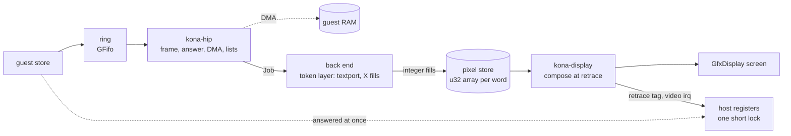
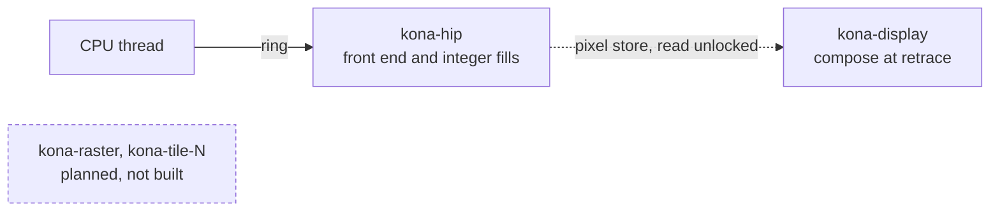

# InfiniteReality (KONA)

Source: `src/dev/kona/` on the `kona` branch. Part of [Graphics boards](README.md).

The InfiniteReality model is on the `kona` branch and not yet in main.

InfiniteReality is the graphics pipe of Onyx and Onyx2 (later Onyx 300 and Onyx 350 as InfiniteReality3/4). This board is in progress: the
back end draws the console, the X server's fills, pixel moves and stipples, and composes the desktop display. GL drawing is planned, not built. The first part of this page is
what exists. The second part, marked as planned, is the design for the rest.

The plan is written down in `clanker/plans/kona-back-end.md` and
`clanker/plans/onyx2-infinitereality.md` on the `clanker-onyx2-plan` branch. They
are not on this branch.

## Built

The pipe is a crosstalk widget. The processor stores commands to one command
page, in one of three grammars (the PROM's textport, the kernel and X server's
commands, and the GL client's) that share the page. A Host Interface Processor
takes the words, answers the commands about the board itself (identity,
configuration, flash, DMA, display lists) and passes everything that draws or
changes display state on. The Geometry Distributor, Geometry Engines, Raster
Managers and Display Generator behind it are the back end.

`kona-hip` runs the front end (`pipe.rs`): it frames each word into a command,
handles what is the board's own, and hands the rest to a `Backend` as a typed
`Job` (`job.rs`), in stream order, on the same thread. The back end (`back/`) owns
what the job changes. It handles the textport, the X server's integer fills and
the display. Most GL commands are counted and dropped; buffer configuration is handled.

The board is given three handles instead of a bus and an interrupt controller
(`attach.rs`): one to send interrupt packets, one for host DMA, one called when
the FIFO has drained. The attach interface names no Hub or HEART type; the machine's glue
implements the three handles.

The state of the front end sits in a slot (`Shared::pipe`). The thread, or a
processor that finds the ring empty, takes it out for an instant, works with no
lock and puts it back. A taken slot is busy to the bus. The machine's DMA,
interrupt and FIFO handles are therefore never called with a board lock held.

Pixel memory is one `u32` array per word of a pixel's record, each the size of
the managed area, allocated whole on first write and published through a fixed
atomic pointer (`back/store/`). The record can hold many words, laid out by the
window's buffer configuration. A fill that touches one word writes contiguous
memory, and a window that uses 13 words allocates 13 arrays. The elements are
relaxed atomics, so a display read that races a write is defined and costs a plain
load. Which physical memory holds a pixel is unknown, and the function from
(pixel, word) to storage is behind one method (`word_slot`).

A retrace request carries a tag. The display thread completes the requests
waiting at each frame boundary, sets the retrace tag register and raises the
video interrupt through a `DisplayHandle` (`handle.rs`), which holds the
front end weakly and drops calls made in a previous reset epoch.

Not modelled: which Raster Manager holds a pixel, raster-bus words and
flow-control credits.

## The pipeline

On the real pipe the Geometry Engines transform, light and clip. Each Raster
Manager (one, two or four per pipe) has one Fragment Generator, which sets triangles
up from screen-space vertices, scan-converts, computes texture addresses, filters
texels, applies fog and does the alpha test. Its Image Engines do the per-fragment
operations and hold the frame buffer. The Display Generator reads the pixels out. Dashed boxes are planned.

```mermaid
flowchart LR
  A["<b>Transform and lighting</b><br/>Hardware: Geometry Engines<br/>Iris, planned: shared GL core in the token layer,<br/>on kona-hip"]
  B["<b>Clipping</b><br/>Hardware: Geometry Engines<br/>Iris, planned: shared GL core, then a window-space<br/>clip before the hand-off"]
  C["<b>Set-up</b><br/>Hardware: Fragment Generator, from screen-space vertices<br/>Iris, planned: kona-raster, exact integer edges"]
  D["<b>Rasterisation</b><br/>Hardware: Fragment Generator, scan conversion<br/>Iris, planned: kona-tile-N workers in 2x2 quads"]
  E["<b>Shading and texture</b><br/>Hardware: Fragment Generator, texture<br/>addressing, filtering, fog, alpha test<br/>Iris, planned: tile workers"]
  G["<b>Per-fragment operations</b><br/>Hardware: Image Engines<br/>Iris, planned: tile workers.<br/>Built today: integer fills, pixel moves, stipples"]
  H[("<b>Frame buffer</b><br/>Hardware: Image Engines, one 256K x 32 SDRAM each<br/>Iris, built: one u32 array per pixel word")]
  I["<b>Scan-out</b><br/>Hardware: Display Generator<br/>Iris, built: kona-display composes at retrace"]
  A --> B --> C --> D --> E --> G --> H --> I
  classDef planned stroke-dasharray: 4 3
  class A,B,C,D,E,G planned
```

## 2D drawing

The textport and the X server's integer fills, pixel moves and stipples run on
the kona-hip front-end thread. What the board does with these commands is not
publicly documented.

## Threads

The front end runs the ring and the integer fills on one thread. The raster and
tile threads belong to the planned back end and are not built yet.

## Planned: the drawing back end

None of this is built. Nothing available gives hardware pixels, so the whole back
end is an approximation, and no test will claim pixel accuracy. Unexpected input
is counted per kind, shown by the `kona` monitor commands and logged. Nothing is
answered with a made-up success.

### From a GL token to pixels

Front-end tokens become typed jobs. The token layer runs on the front end's
thread, in stream order. It tracks GL contexts and uses the shared GL core
(`src/dev/gl/`) for transform, lighting, clipping and window mapping, the way VPro
does: the board's vertex type implements `ClipVertex`, and clipping and
projection run under the board's own `Geometry`, so the core needs no change.
Primitive assembly, cull, polygon modes and the window-space clip are the board's
own.

```mermaid
flowchart LR
  CMD["Job::Command, grammar Gl<br/>selector, args, packed"] --> TL["token layer<br/>match on selector"]
  TL -- "state tokens" --> CTX["context slot<br/>GL state from the shared core,<br/>plus raster state in groups"]
  TL -- "vertex tokens" --> XF["transform and light<br/>math::xform, Lighting::light_vertex"]
  CTX --> XF
  XF --> ASM["primitive assembly<br/>strips, fans, quads, polygons<br/>to triangles, lines, points"]
  ASM --> CLIP["clip_polygon_by with the board's Geometry,<br/>window mapping, quantising for the hand-off"]
  CLIP --> JOB["RasterJob: typed vertices<br/>plus an Arc of each state group"]
  CTX -- "snapshot per draw" --> JOB
  JOB --> SCHED["tile scheduler<br/>one owner per tile"]
  SCHED --> SET["set-up in the raster stage<br/>exact integer edges on a 1/8 pixel grid"]
  SET --> QUAD["2x2 quads: plane equations at each pixel,<br/>integer or reproducible f32"]
  QUAD --> FOP["texture, fog, then<br/>stencil, depth, blend, logic op"]
  FOP --> STORE[("pixel store")]
  classDef planned stroke-dasharray: 4 3
  class CMD,TL,CTX,XF,ASM,CLIP,JOB,SCHED,SET,QUAD,FOP planned
```

- **Typed jobs, not bus words.** The token layer hands the raster stage typed
  vertices and state. Raster state sits in one struct per functional group behind
  an `Arc`, snapshotted once per draw, not sent as register writes in the stream.
  A fixed pool of group records, as VPro uses, is the fallback if the snapshots
  cost too much.
- **The hand-off is vertices, not registers.** The raster stage assembles the
  primitive and computes slopes itself, so set-up belongs to the raster stage.
  IMPACT's `Gl::triangle` has no counterpart.
- **Window-space clip, not clamp.** The Geometry Engines clip. How the near and
  far planes are handled is not publicly documented. The model clips each polygon to the
  scissor in window space before quantising, the way IMPACT does, because
  clamping coordinates would change slopes.
- **A fourth texture word.** The Fragment Generator interpolates texture
  coordinates perspective-correct. That each textured vertex carries a fourth word
  is inferred from OpenGL's four-component texture coordinates. Its form
  (1/w, q/w or 1/q) is unknown. Colour is taken as linear in screen space.
- **One snap.** The token layer truncates window positions toward minus infinity
  onto a 1/256 pixel grid once, and set-up takes that value to 1/8 pixel exactly,
  so nothing rounds twice.
- **One pixel store.** The Raster Managers split pixels between them, but a guest
  cannot tell which one holds a pixel, so the model keeps one store, plane-major
  as above, with one texture store.
- **Tiles with one owner each.** A tile scheduler of the board's own follows the
  rules in `clanker/odyssey/screen-tiles.md`: the raster stage queues each
  primitive on every tile it touches, and a worker owns a ready tile until its
  queue is empty. The raster stage evaluates plane equations at every pixel,
  where IMPACT steps iterators along an edge. The per-pixel arithmetic stays in
  integers or `f32` operations a GPU reproduces; `f64` appears only in set-up.
  VPro's ring and queues are tied to VPro's types and are not shared. Planned
  threads: `kona-hip` for the front end and token layer, `kona-raster` for set-up
  and binning, `kona-tile-N` for the tile workers and `kona-display`.
- **Display at retrace.** The display thread composes the whole frame at retrace
  from the pixel store and the display tables, with no change tracking, as VPro
  does. Swaps and retrace requests carry a ticket and complete at a frame
  boundary.
- **The host GPU, planned and not built.** A wgpu raster path would reuse the
  batch, memory and scan-out layers in `src/wgpu` with the board's own records and
  kernels. The CPU path keeps three constraints for it: the per-pixel stage is
  integer or reproducible `f32`, `WordArray::store` is the one write point into
  the pixel store, and the records at the raster boundary are flat data with no
  pointers.

### Approximations

Everything on the planned path is approximated or unknown, and the plan grades each
item. In short: the token layer stands in for the geometry engines and the board's
firmware; vertices travel as typed values, not bus words; the vertex snap,
sample rule and half-pixel offset are the model's; the z range clipped and the depth
representation are unknown, and the fourth texture word is inferred;
fragment-operation order, blend and dither arithmetic, line and point rules,
stipple and texture filtering are unknown; completion is by draining and swaps by
ticket; no flow-control credits are counted; and an InfiniteReality3 renders as an
InfiniteReality2.

## Monitor commands and tests

This branch has no InfiniteReality monitor commands or tests. They are on the
kona branch.
