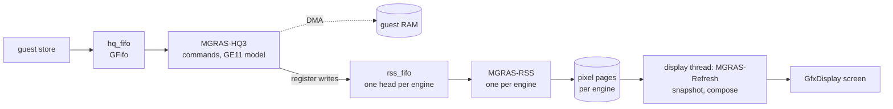
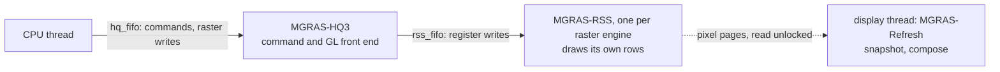

# IMPACT (MGRAS)

Source: `src/dev/mgras/`. Part of [Graphics boards](README.md).

IMPACT is the graphics board of the Indigo2 IMPACT and, behind a different host
interface (`hq4.rs`), of the Octane. The host talks to one chip, the host
interface, in a 1 MB window (2 MB on the Octane). Commands arrive as (command, data) pairs. Low numbers
go to the command processor; `0x1000` and up write raster registers, with a bit
meaning "execute". The model does not run the uploaded microcode: `MGRAS-HQ3`
interprets the command and GL token stream directly (`hq3.rs`, `gl.rs`), using the
shared GL core in `src/dev/gl/` for transform, lighting and clipping.

What the front end passes on is what the hardware passes: register writes. The
second ring (`rss_fifo`) carries `(register, execute)` entries and DMA payload.
It is a broadcast queue with one head per raster engine. On Maximum IMPACT two raster threads take every entry. With two raster engines, one draws the even scanlines and the other the odd scanlines, and each Iris thread draws only its own rows. `IRIS_MGRAS_ENGINES` can start up to four; the extra threads share the two engines' pixel memory.

## The pipeline

The geometry engines (GE11) do the per-vertex work and hand the raster engine (RE4) vertex, colour and texture data. RE4 breaks primitives into spans, and steps colour, depth and texture coordinates across them. The texture engine (TE1) iterates texture coordinates and level of detail for the texture RAM (TRAM), which fetches and filters texels for RE4. RE4 applies texture environment and fog. The pixel engines (PP1) own the pixel memory and apply the alpha, depth and stencil tests, blending, dithering and masking. Iris merges RE4, TE1 and PP1 into one raster thread
per engine.

```mermaid
flowchart LR
  A["<b>Transform and lighting</b><br/>Hardware: GE11 microcode<br/>Iris: shared GL core, driven from mgras/gl.rs<br/>on MGRAS-HQ3"]
  B["<b>Clipping</b><br/>Hardware: GE11<br/>Iris: shared GL core, then cull, polygon mode<br/>and scissor in mgras/gl.rs"]
  C["<b>Set-up</b><br/>Hardware: GE11 sends vertex, colour and<br/>texture data to RE4; slopes not documented<br/>Iris: Gl::triangle on MGRAS-HQ3, then the raster<br/>thread reads the registers back"]
  D["<b>Rasterisation</b><br/>Hardware: RE4 breaks the primitive into spans<br/>Iris: MGRAS-RSS, one thread per engine,<br/>interpreter or Cranelift JIT"]
  E["<b>Shading and texture</b><br/>Hardware: TE1 iterates coordinates and LOD;<br/>TRAM fetches and filters; RE4 does texture<br/>environment and fog<br/>Iris: same raster thread, te1.rs sampler"]
  G["<b>Per-fragment operations</b><br/>Hardware: PP1 (alpha, depth and stencil tests,<br/>blend, dither, masking); fog in RE4<br/>Iris: same raster thread"]
  H[("<b>Frame buffer</b><br/>Hardware: RDRAM, 12 MB per raster engine,<br/>behind its two PP1 chips<br/>Iris: pages of 36-bit words per engine")]
  I["<b>Scan-out</b><br/>Hardware: CMAP colour look-up and gamma, VIO1,<br/>RAMDAC; VC3 timing (inferred). Window-ID and<br/>mode tables not publicly documented<br/>Iris: display thread (MGRAS-Refresh)"]
  A --> B --> C --> D --> E --> G --> H --> I
```

## Data flow

Iris models the RDRAM as pages of 36-bit words (`pixmem.rs`); a page is one screen tile. The display snapshots the window-ID runs, the mode words and
the colour tables before each retrace pulse, when the picture changed or every sixth idle frame, then makes one pass over the
pixels (`frame.rs`). The pixel pipeline has an interpreter and an optional
Cranelift compiler (`rss_jit/`, cargo feature `gr4-jit`, also in `gpujit`; not
a default feature), each tested against the other. `IRIS_GR4_JIT` sets the
start mode (`off`, `sync` or `async`, the default); `IRIS_NO_JIT` forces it off.

Producers take a `submit` lock while they push. Anyone who needs the engines
idle (reads of drawing state, checkpoints, the monitor) takes the same lock.

## 2D drawing

Block, line, put and transfer commands are written to the raster registers and
drawn by the MGRAS-RSS raster threads (`mgras/rss.rs`).

## Threads

The rss FIFO has one head per raster engine. Each engine reads every register write and draws only its own rows.

## From a GL token to pixels

The model does not run the geometry engines' microcode; `Gl` stands in for it
at the level of the GL call, using the shared GL core (`src/dev/gl/`) for the
math. The raster engine is handed register writes.

```mermaid
flowchart LR
  CMD["(command, data) from hq_fifo"] --> DISP["Hq3Engine::dispatch<br/>hq3.rs"]
  DISP --> TOK["Gl::token<br/>gl.rs: match on the token"]
  TOK -- "state tokens" --> ST["Gl: one plain struct per context<br/>matrix stacks, Lighting, Clip, Viewport,<br/>blend, depth, stencil, scissor"]
  TOK -- "vertex token" --> XF["Gl::transform<br/>math::xform, Lighting::light_vertex,<br/>Clip::outcode, Viewport::project"]
  ST --> XF
  XF --> ASM["Gl::vertex<br/>strips, fans, quads, polygons"]
  ASM --> CLIP["Gl::polygon<br/>Clip::clip_polygon, cull, polygon mode,<br/>scissor_polygon"]
  CLIP --> SET["Gl::triangle<br/>edges, slopes and plane steps<br/>written as raster engine registers"]
  ST -- "batch start, state change" --> FRAG["Gl::load_fragment_state<br/>fragment registers"]
  SET -- "rss_write" --> FIFO["rss_fifo<br/>one head per engine"]
  FRAG -- "rss_write" --> FIFO
  FIFO --> RSS["Rss::triangle<br/>tri_setup, then a walk by row"]
  JIT["rss_jit: shader per PipeKey<br/>same arithmetic as the interpreter"] -. "replaces the walk when ready" .-> RSS
  RSS --> FRG["per pixel, in fixed point<br/>planes, texture, fog, then<br/>alpha, stencil, depth, blend, logic op"]
  FRG --> MEM[("pixel pages")]
```

- **Decode.** `Hq3Engine::dispatch` (`hq3.rs`) turns the command words into a
  token number and its data, converts argument formats, and calls
  `Gl::token` (`gl.rs`). Tokens it does not handle are counted and logged.
- **State.** `Gl` is one plain `repr(C)` struct, valid zeroed, saved and
  restored whole with a context. It also keeps a shadow of the raw values the
  GL library set, so that a state query reads back what was sent
  (`glquery.rs`).
- **Transform and light.** `Gl::transform` multiplies by the combined matrix,
  lights the vertex with the shared `Lighting`, computes the clip outcode and
  maps to the window with `Viewport::project` on a grid of 1/256 pixel.
- **Clip and cull.** `Gl::polygon` clips the convex polygon against the view
  volume and user planes (`Clip::clip_polygon`), culls by the signed window
  area, applies the polygon mode and, with the scissor test on, clips to the
  scissor box in window space.
- **Hand-off.** Iris writes edges and slopes as the raster engine's registers. The board's own hand-off is documented only as vertex, colour and texture data.
  `Gl::triangle` sorts the vertices by y, works out the major and minor edge
  slopes, the start values and the steps of each colour, depth and texture
  plane, and writes them as the engine's own registers. The last write
  carries the "execute" bit. Fragment state is written when a batch starts and
  whenever it changes.
- **Raster.** `Rss::triangle` reads the registers back (`tri_setup`, in
  `f64`), then walks rows, finds the span of each (`f64` per row), and steps
  fixed-point planes across it (`fixed.rs`). Per-pixel colour is fixed-point, and texture sampling converts through `f64`. Each
  engine draws only the rows it owns.
- **Texture.** `te1.rs` models the texture engine and its TRAM. Texels arrive
  through the raster engine's transfer path. Per fragment the sampler divides out
  W, picks a level of detail, fetches and filters, and the texture environment
  combines the texel with the fragment colour. Detail textures are modelled (when
  magnifying only). Sharpen textures, 3D textures, texture lookup tables and
  video texture are not.
- **Specialising.** `rss_jit` reduces the registers that shape a pipeline to
  a `PipeKey` and compiles straight-line code for that key on a background
  thread, with the interpreter drawing until it is ready. A comparison test draws the same primitives both ways and compares the interpreter with the compiled path.

## On the host GPU

With `[graphics] raster = "wgpu"` (`--raster wgpu`; needs a build with the
`wgpu` feature, backend from `[graphics] gpu_backend`) one GPU unit replaces the
raster engine threads (`mgras/wgpu/`). The CPU keeps the register file, the
command decode and triangle and line set-up. Where the interpreter would walk
spans, it hands the primitive to the unit as a record, and compute kernels
(`mgras/wgpu/shaders/`) bin the records to tiles and draw them with the
interpreter's arithmetic. Pixel pages live in a GPU buffer, with the CPU copy
kept as a mirror for readers. Scan-out runs on the GPU too
(`mgras/wgpu/scanout.rs`), and a frame is read back only when something
asks for the pixels. One unit draws every scanline, so `IRIS_MGRAS_ENGINES`
does not apply. `MGRAS_BIN_EDGES=0` makes the bin pass use primitive boxes
instead of testing spans per tile.

## Monitor commands and tests

The monitor command is `mgras` (`mgras/debug.rs`): `status`, `hq`, `gl`, `ge`,
`ucode`, `vc3`, `xmap`, `cmap`, `dac`, `pix`, `stats`, `shot`, `fbdump`,
`trace`, `rec`, `probe`, `dump`, `tram` and, with `gr4-jit`, `jit`. The trace needs the
`gputrace` feature (on with `developer`). `IRIS_MGRAS_TRACE=<file>` starts it at power-on and `IRIS_MGRAS_REC=<file>` starts a recording
(`record.rs`, which also replays recordings in tests). `mgras_tests.rs`,
`rss_jit_tests.rs` and `mgras/wgpu/tests.rs` hold the tests.
