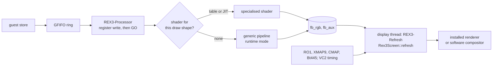
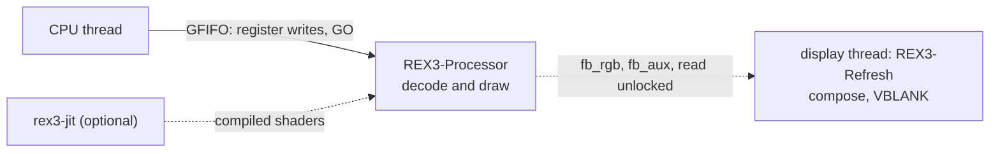

# Newport (REX3)

Source: `src/dev/ng1/`. Part of [Graphics boards](README.md).
Paths are relative to that directory unless they start with another one.

Newport is the graphics board of the Indy (IP24) and the Indigo2 XL (IP22). Its
drawing chip is REX3. Iris models two planes of 2048 x 1024 words, an RGB plane and an auxiliary one. Video timing is VC2, the window-ID cross-map is XMAP9, the
colour map is CMAP, and the RAMDAC is Bt445. The guest reaches the drawing engine
through an 8 KB register window. A draw is one register write, or a run of them,
followed by a GO. The machine can give a second head (`graphics.heads = 2`),
which is a second `Rex3`.

The board keeps the FIFO shape the README describes. Stores go into a ring, and
one thread drains it and does the drawing. A separate thread composes the screen
about 60 times a second.

## The pipeline

Newport has no geometry hardware. The guest's graphics library, running on the
guest CPU, transforms, lights and clips, and cuts each shape into spans, lines
and blocks. REX3 receives those as register writes, steps along them one pixel
at a time, shades, applies its write modes and stores. The board has no hardware depth buffer and no texture hardware. Z buffering is done by the host in system memory. The frame buffer holds pixel planes plus overlay, pop-up and window-ID (CID) planes.

```mermaid
flowchart LR
  A["<b>Transform and lighting</b><br/>No hardware. The guest CPU does it<br/>as ordinary guest code."]
  B["<b>Clipping</b><br/>Hardware: the guest CPU clips shapes;<br/>REX3 masks pixels with its clip masks<br/>Iris: REX3 draw path"]
  C["<b>Set-up</b><br/>No hardware. The guest CPU writes start values<br/>and steps for each span or line<br/>Iris: register writes on REX3-Processor"]
  D["<b>Rasterisation</b><br/>Hardware: REX3 steps spans, blocks and lines<br/>Iris: REX3-Processor, through a shader table,<br/>the Cranelift JIT or the generic path"]
  E["<b>Shading and texture</b><br/>Hardware: REX3 colour iterators. No texture<br/>Iris: same draw path"]
  G["<b>Per-fragment operations</b><br/>Hardware: REX3 pattern, logic op, blend, dither.<br/>No hardware depth<br/>Iris: same draw path"]
  H[("<b>Frame buffer</b><br/>Hardware: two VRAM planes<br/>Iris: two word arrays, fb_rgb and fb_aux")]
  I["<b>Scan-out</b><br/>Hardware: RO1 reads VRAM; XMAP9, CMAP and Bt445; VC2 timing<br/>Iris: display thread (REX3-Refresh) composes the frame"]
  A --> B --> C --> D --> E --> G --> H --> I
  classDef absent stroke-dasharray: 4 3
  class A,C absent
```

Dashed boxes are stages the board does not have. The guest CPU does that work.

## Data flow

## From a store to the drawing engine

A store to the register window goes through `bus_write32`. Most registers are
queued with `gfifo_try_push`. The push is the store's only effect, so a full ring
returns `BUS_BUSY` and the CPU runs the store again later. CONFIG and the DCB
registers (DCBMODE, DCBDATA0/1, DCBRESET) act on the CPU thread at once instead
(`reg_needs_cpu_side_effect`).

The GFIFO is a software ring far deeper than the hardware FIFO. The STATUS
register reports the level against the hardware's 32-entry depth
(`GFIFO_HW_DEPTH`). The guest polls that level, not the ring.

A register write with the GO bit set also queues a `GFIFO_PURE_GO` entry. Host
data (HOSTRW) goes through the same ring. A batched transfer is one token
followed by its words, so a full-line blit costs one round trip, not one per
8 bytes.

Reads come in two kinds. Reads of drawing state (`busy_or_val!`) return
`BUS_BUSY` while the ring holds entries or the processor is working. The rest
answer at once.

The processor thread (`register_processor`) takes one entry at a time. It applies
the register write and, on a GO, runs `execute_go` or the STEPZ variant. Then it
retires the entry. After the ring stays empty, the thread parks for up to 2 ms at a time,
and the next store wakes it.

## 2D drawing

REX3 draws the 2D commands (blocks, spans and lines) on the REX3-Processor
thread (`rex3.rs`, `execute_go`). Logic ops and write masks come from the
generic pixel pipeline (`rex3_generic.rs`).

## Threads

- **REX3-Processor.** Applies register writes and draws. It owns the drawing
  context while it runs.
- **Display thread** (REX3-Refresh, `refresh_loop`). Waits for the XMAP fence, composes the
  frame, presents it and asserts VBLANK.
- **rex3-jit.** The Cranelift compiler, built only with the `rex-jit` feature
  (`rex3_jit/`). It takes requests from a two-lane queue (`rex3_jit_queue.rs`).
  The hot lane holds shapes the draw path is waiting for and is never dropped.
  The cold lane is for warm-up and drops requests when full.
- **rex3-jit-warmup.** The JIT's warm-up thread (`rex3_jit/mod.rs`).
- Screenshots are written by a short-lived thread.

The processor owns the board state. The display thread reads the frame buffers
with no lock and accepts tearing. The VC2, CMAP, XMAP9 and
Bt445 state is copied under each device's own lock.

## Where drawing happens

`execute_go` picks the shader for a draw in this order:

1. The shape key is `(DRAWMODE0, DRAWMODE1 normalised, CLIPMODE key)`.
   `normalize_dm1` (`rex3_shape.rs`) drops bits that cannot change the result,
   such as BLEND under FASTCLEAR.
2. A lookup in the shader map. The map is seeded from `SHADERS`
   (`rex3_shaders.rs`), one entry per draw shape in a saved corpus.
   `tools/gen_rex3_shaders.py` generates it from the profile the emulator writes
   on exit (`rex3_profile.rs`). Each entry is the generic pipeline instantiated
   with every mode field as a constant. The header names the profile it was generated from, a file on the original author's machine; that profile is not in the repository.
3. On a miss, if the JIT is built and enabled, the shape is queued for Cranelift.
   The draw runs on the generic path in the meantime.
4. The generic path (`rex3_generic.rs`) runs the same source with mode values read
   at run time (`DynMode`). The `Mode` trait is what lets one pipeline serve both.
   The draw core is `draw_with_fb`.

The Cranelift JIT is not in the default build. `rex-jit` is left out of the default
features. When it is on, some shapes are refused and stay on the generic path:
lines with host data, primitives with full host data, and some address modes
(`rex3_jit/compiler.rs`). `IRIS_NO_JIT` turns it off at run time. A shape the
monitor disables with `rex jit disable` also stays on the generic path.

The pixel pipeline covers the write modes: compare, logic op, blend, dither, host
data, and the stepping rules for blocks, spans and lines. A STEPZ GO steps the
iterators over one pixel and leaves the pattern as the guest set it
(`execute_stepz_go`).

There are two host-GPU paths. `rex-gpu` (`rex3_gpu.rs`) is a replay-only prototype
behind its own feature. The `wgpu` feature composes the display on the GPU for the
window (`Ng1Scanout`, in `wgpu/`, used from `src/ui.rs`). Neither changes what the
processor does.

## Board memory and scan-out

There is no video memory apart from the frame buffers. `fb_rgb` and `fb_aux` are
two `Box<[u32]>` of 2048 x 1024 words. Each bit of a pixel is one plane. The
auxiliary plane carries the overlay, popup and CID planes (`CompositorSource`,
`src/compositor.rs`).

`rex-dirty-upload`, off by default, tracks damage in tiles (`rex3_dirty.rs`), so a
frame uploads only the parts that changed.

What appears on screen is set by the VC2 timing, the XMAP9 mode table, the CMAP
and the RAMDAC. `Rex3Screen::refresh` (`src/disp.rs`) copies the VC2 RAM and
registers, the CMAP, the Bt445 palette and the XMAP9 modes into the screen's own
copies, and only where the source is dirty. The window-ID buffer is built from the
DID entries in `decode_did`.

Mode changes are fenced. Each XMAP mode-table write queues a `GFIFO_DISP_SYNC`.
The display thread waits for the processor to pass it, for up to 50 ms,
so the frame that follows uses the new mode.

## Display and presentation

The refresh loop runs at 60 Hz. It composes only when something visible changed:
the frame buffer is dirty, a palette or mode changed, a debug overlay is on, a
screenshot or frame is wanted, or a run of frames has gone by with nothing to do
(`IDLE_HEARTBEAT_FRAMES`). An idle frame still asserts VBLANK and latches the
cursor Y, so guest timing does not depend on the host.

The composed frame is `screen.rgba` (`0xAABBGGRR`). It goes to the installed
renderer, which draws it in a window with the status bar. With no renderer, as
with `--ci`, the software compositor builds it instead
(`SwCompositor::compose_pixels`, `src/compositor.rs`). Screenshots and VNC frames
read the same buffer.

## Monitor commands

The `rex` family:

- `rex status`, `rex diag`, `rex fbdump [DIR]`
- `rex jit on|off|status|list`, `rex jit disable|enable <dm0> <dm1>`
- `rex shaders list`
- `rex debug on|off [DEV]`, `rex cmap on|off`
- `rex trace <file> [gfifo,cpu|all]`, `rex trace off|flush`
- `rex rec <file>`, `rex rec mark|off`

The device commands: `vc2 status|ramdump`, `xmap status|dump`,
`cmap status|dump`, `bt445 status|identity`, `dcb debug`, `disp status|debug|compositor`.

## Tests and benchmarks

- `rex3_tests.rs`: unit tests that start the real processor thread through
  `make_rex3`, drive it through the bus, and read the frame buffers directly.
- `rex3_rec.rs`: a replayable recording of every bus access and DMA, with hash
  checkpoints. `rex rec <file>` or `IRIS_REX3_REC=<file>` writes one. The test
  `rex3_replay_file` replays the file named by `REX3_REPLAY`.
  `REX3_REPLAY_ENGINE=interp|jit|gpu` picks the draw path.
- Smaller test sets sit beside the code: `rex3_shape.rs`, `rex3_jit_queue.rs`,
  `vc2_timings.rs`, `wgpu/tests.rs`, `tests/rex3_dirty.rs`, and `rex3_gpu.rs`
  (behind `rex-gpu`).
- Benchmarks are ignored tests in `rex3_tests.rs` (the `gfifo_*` ones and
  `dispatch_lookup_cost`). Run them with `--ignored`.
- `examples/rex3_gpu_probe.rs` probes the host-GPU path.

Design notes for this board are in `clanker/rex3/`. The published documents for
its chips are in `docs/datasheets/indy/`: `rex3.pdf`, `vc2.pdf`, `xmap9.pdf`, `bt445_ramdac.pdf`
and `cmap_MS622424.pdf`.
