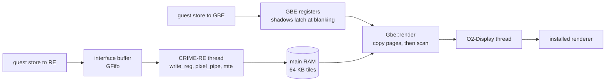
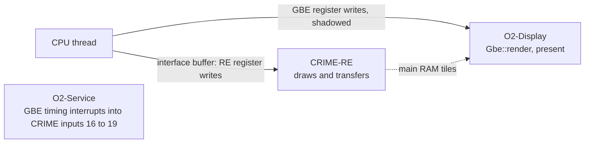

# O2 graphics (CRIME and GBE)

Source: `src/dev/o2gfx.rs`, `src/dev/crime.rs`, `src/dev/crime_mem.rs` and
`src/dev/o2gfx_trace.rs`. Part of [Graphics boards](README.md).
Paths are relative to `src/dev/` unless they start with `src/`. The machine is
described in [docs/o2-ip32.md](../o2-ip32.md).

The O2 has no video memory. The frame buffer is ordinary main RAM, cut into 64 KB
tiles. Two blocks work on it. GBE, a block of its own, scans the frame out to the
screen. The rendering engine (RE), inside CRIME, draws into it, and the memory
transfer engine (MTE) that belongs to the RE copies pixels around. Both are DMA
masters on the memory controller.
CRIME is also the memory controller and the interrupt controller for the board.
Its registers sit at `0x14000000`, the rendering engine at `0x15000000`, and GBE
at `0x16000000` (`src/ip32.rs`).

Writes to the rendering engine are queued and then applied by its own thread. GBE
registers are written directly. Its shadow registers take effect at vertical
blanking. Scan-out is a function of RAM and the GBE registers, so the display
thread does not share state with the engine.

## The pipeline

The O2 has no geometry hardware. The guest's graphics library transforms, lights and clips on the guest CPU, then writes the rendering engine's registers; `pixel_pipe` builds each triangle's edge functions from them. The engine finds the pixels each triangle covers, textures and shades them, applies the per-pixel tests and writes the
result into RAM. GBE reads RAM back out.

```mermaid
flowchart LR
  A["<b>Transform and lighting</b><br/>No hardware. The guest CPU does it<br/>as ordinary guest code."]
  B["<b>Clipping</b><br/>Hardware: the guest CPU clips shapes;<br/>the RE masks pixels with its clip registers<br/>Iris: Clip::new in pixel_pipe"]
  C["<b>Set-up</b><br/>Hardware: CPU computes plane-equation parameters;<br/>the RE rasterises from window coordinates<br/>Iris: pixel_pipe builds edge functions"]
  D["<b>Rasterisation</b><br/>Hardware: the RE, in CRIME (rendering engine)<br/>Iris: CRIME-RE thread, row by row between edges,<br/>plain CPU code with no specialisation"]
  E["<b>Shading and texture</b><br/>Hardware: the RE; textures through a texture TLB<br/>Iris: same thread; Texture::sample"]
  G["<b>Per-fragment operations</b><br/>Hardware: the RE: alpha test, depth, stencil,<br/>blend, dither (8- and 16-bit RGB formats), logic op<br/>Iris: same thread, registers tested as it runs"]
  H[("<b>Frame buffer</b><br/>Hardware: main RAM in 64 KB tiles<br/>Iris: guest RAM, written through the same path<br/>as the CPU")]
  I["<b>Scan-out</b><br/>Hardware: GBE<br/>Iris: O2-Display thread, Gbe::render"]
  A --> B --> C --> D --> E --> G --> H --> I
  classDef absent stroke-dasharray: 4 3
  class A absent
```

## Data flow

## From a store to the engine

A store to the rendering engine is `CrimeRe::write32` or `write64`, which calls
`cpu_write`. The write goes into the interface buffer, `ib`, a `GFifo`
(`IB_DEPTH`). When it is full, or the engine is busy, the store returns
`BUS_BUSY` and the CPU retries it. A 64-bit store is marked with the `WIDE` bit.

The engine thread takes entries in order and applies each one (`run`). A store to
a register in page `0x2000` or `0x3000` with bit 11 set starts the work instead of
only setting the register. Page `0x2000` starts a primitive (`pixel_pipe`). Page
`0x3000` starts a transfer (`mte`). The start is in `write_reg`.

A read of the engine's registers while it is busy answers `BUS_BUSY` (`read_reg`).
The status word reports the buffer level as CRIME's own FIFO would show it
(`read_reg_now`). A status read first waits up to 100 us for the engine to go idle,
or 20 ms when the previous poll found it busy.

GBE's registers are written in place (`Gbe::write_reg`). A write to a shadowed
register goes to a pending list with the frame number. The pending writes are
copied to the live registers at the start of vertical blanking (`latch`).

## 2D drawing

Points, lines, rectangles and memory transfers (MTE) run on the CRIME-RE thread
(`o2gfx.rs`).

## Threads

- **CRIME-RE** (`run`). The rendering engine. It spins for 250 us when idle, then
  parks (`sleep`) for up to 50 ms, and a store wakes it.
- **O2-Service** (`ip32_machine.rs`). Runs the device service loop. It drives
  GBE's timing interrupts into CRIME inputs 16 to 19 (`Gbe::service`,
  `Ip32Bus::service`).
- **O2-Display** (`display_loop` in `ip32_machine.rs`). Scan-out and
  presentation.
- **O2-Control** (`ip32_machine.rs`). The control port, started only when
  `[o2] control_port` is set.

The engine's register copy is locked for the length of one primitive. The memory
window takes its own lock only on the engine's thread. The RE writes pixels through
the same write path as the CPU, so the CPU's own JIT sees them (`o2gfx.rs` header).

## Where drawing happens

`pixel_pipe` runs one primitive to completion. It takes the mode and primitive
registers, clips with `Clip::new`, and branches on the registers at run time for
each stage. Triangles are scanned row by row between their edges. Points, lines and
rectangles have their own paths, and GL lines go through `gl_line`. Blend is
`blend`, dither is `dither5`, the alpha test is `alpha_pass`, and logic ops are
`logic`.

Textures are sampled by `Texture::sample`. A texture is read from its base level
through a texture TLB, with 64 KB tiles of 128 lines of 512 bytes. The 32-byte block layout inside a
tile is not documented; the byte order there is Iris's own model.

There is no specialisation. The code has no const-generic shader and no JIT. Each
primitive tests the registers as it runs. The pipe does not check the clip-ID
test (ClipMode bit 11). Nothing seen so far draws with it on, so the code records a
note when it is set and draws unclipped.

Memory transfers run in `mte`, `mte_linear` and `xfer_linear`. The transfer engine
reads and writes buffer types that differ in pixel size, and converts between them.

## Board memory and scan-out

Frame buffers are named by the engine: a TLB index and
a pixel size per buffer (`buf`). `locate` turns a window coordinate into an address
in those tiles. The TLB entries sit in the engine's registers, so a driver's own
page table decides where a buffer is.

Memory is laid out by CRIME's bank controls, not by the board. CRIME has eight memory-bank
controls. Each bank is 32 MB or 128 MB, depending on the SDRAM size bit, and a bank
control register sets where it answers. A change to a bank control remaps RAM at once.

GBE scans out with `Gbe::render`. The first step is `snapshot`, which copies the
64 KB pages one frame reads: the tile lists, the tiles and the DID table. Scan-out
then runs on the copy, so the CPU is not held up by it. `render` returns nothing,
and the screen goes black, when the video mode field is not set, the dot clock is
stopped, the beam is frozen, the timing is empty, the output buffer is too small, or `VT_FLAGS & 0xa` is `0xa`.

The beam position comes from guest time and from reads of VT_XY. Each read moves
the beam a little, so a poll for blanking sees it move.

## Display and presentation

`display_loop` runs at 60 Hz. It calls `render_screen` (`ip32.rs`) into an RGBA
buffer, copies the picture into the screen with the board's size, and presents it
through the installed renderer. A frame with the display off is black. The size
stays at the last picture size, or 1280 x 1024 if there was none. The control
port's `o2 shot` calls `render_screen` on demand.

## Monitor commands

- `gbe status`, `gbe trace <file> [re,cpu,gbe,crime,irq|all]`, `gbe trace off|flush`
- `re status`, `re notes`, `re dither [on|off]`, `re trace <file> [re,cpu,gbe,crime,irq|all]`,
  `re trace off|flush`, `re rec <file>|off`
- `crime status`, `crime regs`, `crime irqlog [on|off|n]`, `crime touched`,
  `crime trace <file> [...]`, `crime trace off|flush`

The `o2` commands (`ip32_machine.rs`) are on the monitor and on the control port,
a TCP socket on `127.0.0.1` that `[o2] control_port` opens. The graphics ones are
`o2 shot <file>`, `o2 pixel X Y` (what scan-out makes of one point: the frame
word, DID, mode-table entry and colour map), `o2 status`, `o2 peek ADDR LEN PATH`
(physical memory, for what a recording lacks) and `o2 retrace PATH` (the engine's
recorded writes). The rest drive the keyboard and mouse and dump CPU and machine
state. `help o2` lists them. The `re`, `gbe` and `crime` commands are in `o2gfx.rs` and `crime.rs`.

The trace (`o2gfx_trace.rs`) writes lines from the RE, CPU, GBE and CRIME blocks
into one file. `IRIS_O2_TRACE=<file>` starts one at power-on. `re rec` records
the engine's writes in a form the replay test reads. Traces and `re rec` need a
build with the `gputrace` feature, which `developer` turns on.

## Tests and benchmarks

- `o2gfx.rs`: tests of the GBE and CRIME save and load, the texel layouts, the
  blend and dither paths, the stencil and alpha tests, the status wait and the
  busy engine. They build the engine directly with `TestRe`.
- `crime_mem.rs`: tests of the bank decode.
- Replay: `replay_a_recorded_trace` replays a file named by `RE_REPLAY`, and can
  write a PNG (`RE_REPLAY_PNG`) and preload tiles (`RE_REPLAY_PRELOAD`).
  `replay_speed` times the same file, with `RE_SPEED` and `RE_SPEED_PASSES`. Both
  are ignored by default.
- The design notes are in `clanker/devices/` (the `o2-*` and `ip32-o2-*` files).
