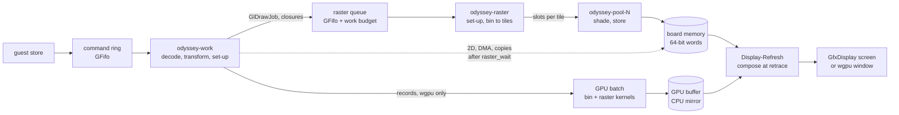
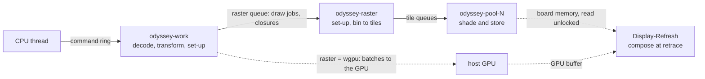

# VPro (Odyssey)

Source: `src/dev/odyssey/`. Part of [Graphics boards](README.md).

Iris models VPro on Octane, Fuel, Tezro and the Onyx 3000 V-brick, with the
variants restricted by each machine profile. A front-end ASIC does the
geometry, the raster work and the texturing, and a back-end ASIC drives scan-out. The processor stores commands to two FIFO ports. Bulk pixel data moves
by DMA descriptors that walk a page table in guest memory.

## The pipeline

The white paper names two ASICs. The front end, VPro's OpenGL on a Chip (Buzz), does the geometry and the rasterisation. The back end, Pixel Blaster & Jammer, drives the display. The FIFO between them is not publicly documented. In Iris, the model runs geometry on its front-end thread and rasterises on tile workers, or on the host GPU.

```mermaid
flowchart LR
  A["<b>Transform and lighting</b><br/>Hardware: VPro front end (Buzz)<br/>Iris: shared GL core, on odyssey-work"]
  B["<b>Clipping</b><br/>Hardware: VPro front end (Buzz)<br/>Iris: shared GL core, in pipe/setup.rs"]
  C["<b>Set-up</b><br/>Hardware: VPro front end (Buzz)<br/>Iris: odyssey-work builds a GlDrawJob;<br/>odyssey-raster sets the primitive up again<br/>for the pixel stage"]
  D["<b>Rasterisation</b><br/>Hardware: the front end's raster unit (pixel order not documented)<br/>Iris: odyssey-raster bins to screen tiles;<br/>odyssey-pool workers walk them,<br/>or GPU bin and raster kernels"]
  E["<b>Shading and texture</b><br/>Hardware: the front end's raster and texture units<br/>Iris: pool workers, SIMD quad kernels;<br/>or the GPU raster kernel.<br/>Sampling widths approximated"]
  G["<b>Per-fragment operations</b><br/>Hardware: OpenGL 1.2 per-fragment operations<br/>(inferred: stencil, depth, blend, logic op, colour mask)<br/>Iris: same workers, kernels chosen once per draw"]
  H[("<b>Frame buffer</b><br/>Hardware: board SDRAM, shared with textures<br/>and the command FIFO<br/>Iris: one array of 64-bit words, or a GPU buffer<br/>with a CPU mirror")]
  I["<b>Scan-out</b><br/>Hardware: Pixel Blaster & Jammer back end<br/>Iris: Display-Refresh composes at retrace<br/>when something it reads changed"]
  A --> B --> C --> D --> E --> G --> H --> I
```

## Data flow

`odyssey-work` is the front end. It decodes each store (`command.rs`), tracks
state, transforms, lights, clips and sets primitives up (`assembly.rs`,
`geometry.rs`). A GL primitive crosses to the raster unit as a `GlDrawJob`
(`gl.rs`): its raster rules, draw state, vertices, texture chain and the texture
tables it reads. Everything else (a clear, a fence, a query) crosses as a closure
over what it needs. Finished jobs come back on a small return ring so a draw
allocates nothing. The front end waits when the queued work, estimated in pixels,
passes a budget (`RASTER_WORK_BUDGET`), not when a job count is reached.

`odyssey-raster` sets each primitive up again for the pixel stage and writes it
as one slot in a ring (`pipe/ring.rs`): a triangle and its bounding box, a quad it
shaded itself, or a clear's rectangle. The slot's index goes on the queue of each screen tile the command touches. A pool worker (`odyssey-pool-N`; the count is
`[graphics] threads`, default 2; the tile size is `[graphics] tile`, a power of two from 8 to 256, default 32) takes a ready tile, owns it until its queue is empty, walks each triangle within the tile in 2x2 quads (an Iris choice; the board's pixel order is not documented) and shades and stores each quad. Iris keeps one owner per tile, so pixels stay in order. The stage state is kept as
the board's own register words, grouped by the stage that reads them
(`pipe/state.rs`), and the per-quad kernels are specialised by const generics and
run four pixels at a time on the host's SIMD unit (`pipe/lanes.rs`).

Board memory is one array of 64-bit words, sized once and never moved
(`vram.rs`). A field is a bit range of its word, read by shift and mask, so
nothing byte-swaps. Surfaces over it are named the way the command stream names
them: a base address, a pitch in tiles and a pixel size. The raster unit and the
display reach it through a raw pointer (`VramPtr`) with no lock. The front end's
own memory work (integer drawing, image puts, pixel DMA, copies, reset) first
waits for the raster queue to empty (`Board::raster_wait`), which is the command
stream's order and not a lock.

The retrace comes at the rate of the video format the guest loaded. The
display FIFO keeps the timing generator's frame and line tables and follows
the I2C writes that program the board's clock part; when a mode load ends,
the tables' totals (pixel clocks a line, lines a frame, lines of blanking,
fields) and the clock's frequency become the refresh thread's timing. Until a
format is loaded the board runs at 1280x1024's 60 Hz.

At each retrace the display checks whether anything it reads has changed: a
store to board memory, or a move of a register generation. A GL draw's stores
are judged more finely. A window's two colour buffers, its depth and its
stencil are byte ranges of one pixel, so each tile worker marks what it drew
with the bytes of the pixel it could change and its box, and the display
checks whether a window in that box shows any of those bytes (`Frame::shows`).
Drawing into a back buffer does not, until the swap latched at a retrace
changes which buffer the window shows. With nothing changed, the frame on
show stays. Otherwise it composes the whole screen (`frame.rs`:
`snapshot` reads the scan-out registers, `compose` builds the frame). Each
frame first prepares a reader per window ID, specialised for that ID's pixel
format and size, and gamma tables with the display mode's channel fold. It then
composes 16-line bands tile by tile, reading board memory in order, with
overlay bytes patched over each run. On the CPU path it writes straight into the screen's
frame buffer in the screen's own byte order, under the screen lock, so
presenting needs no copy or swap; the RGBA copy that screenshots, frame requests
and capturing VNC clients read is brought level only when one of them asks.
`Frame::pixel` stays as the per-pixel reference the tests hold `compose` to, and
`vpro scanout save FILE` captures what the scan-out reads for the compose
benchmark to replay offline. Lookup tables and modes are atomic words with a
generation. The swap latch and the display FIFO each keep their own lock, because
the hardware's buffer swap is its own synchronisation point.

## 2D drawing

2D drawing runs through `paint_integer` (`odyssey/draw.rs`) on the
odyssey-work front-end thread, after the raster stage has drained. What the
chip does with these commands is not publicly documented.

## Threads

Work passes down the queues in order. `IRIS_ODSY_BACKEND=inline` keeps the
tile workers off and stores on the raster thread; `IRIS_ODSY_SHADER=inline`
is a separate switch that keeps shading on the raster thread when the tile
workers are on.

## The texture unit

The texture registers and what a draw latches from them are in `pipe/texture.rs`.
The field layouts are what the GL library writes. What the board does with them is
mostly unknown, so the unit samples by OpenGL's rules: it is approximated, not
measured. The unit reads board memory where the level table points. Sub-texel
positions, filter weights, level-of-detail and component widths are the model's
choices, listed at the top of that file.

## On the host GPU

With `[graphics] raster = "wgpu"` (`--raster wgpu`; needs a build with the
`wgpu` feature, backend from `[graphics] gpu_backend`) the raster and pool threads do not start. The
front end appends a fixed-size record per primitive to a batch
(`src/dev/odyssey/wgpu/`), with the state it was issued under in a slot. A batch
is two dispatches: a bin pass gives each screen tile a bitmask over the
primitives, and a raster pass runs one workgroup per busy tile, which walks its
mask in order and stores pixels itself. Board memory lives in a GPU buffer.
The CPU `Vram` stays as a mirror for what still runs on the CPU, kept current by
two dirty maps. Swaps do not wait on the GPU: the retrace latches a flip once the
drawing before the arm is submitted.

The kernels are the CPU model's arithmetic again, held to it word for word by
parity tests. That rules out the host's own rasteriser and samplers, and it
costs care: GPU division is not correctly rounded and compilers fuse
multiply-adds, so the kernels divide with `div_exact` and keep products apart
from sums. `clanker/wgpu/gpu-floats-are-not-the-hosts.md` has the rules.

Two environment variables tune the kernels: `VPRO_BIN_EDGES=0` bins a triangle
by its box instead of testing its edges per tile, and `VPRO_TILE_CACHE=1` keeps
each tile's blocks in workgroup memory (off by default).

## Monitor commands and tests

The monitor command is `vpro` (`odyssey/debug.rs`). `vpro status` is the board
summary; `regs`, `fifo`, `state`, `geom`, `tex`, `win`, `mem`, `backend`, `lut`,
`dispmode` and `cursor` decode the board's state; `pix`, `raw`, `peek`, `shot`,
`scanout save` and `fbdump` read the screen and board memory; `hash`, `unimp` and `refusals`
report replay hashes and what is not modelled; `gpu` shows the GPU unit's
counters. `vpro trace` (a `gputrace` build) and `vpro rec` write a trace and a
replayable recording; `--startup "vpro trace <file>"` and `--startup "vpro rec <file>"` start
them at power-on. `raster_bench.rs` and `display_bench.rs` are the benchmarks
(`BENCH_SCENE`, `BENCH_SECS`), the tests are under `odyssey/tests/`, and
`odyssey/golden/` holds scene and replay checks.
