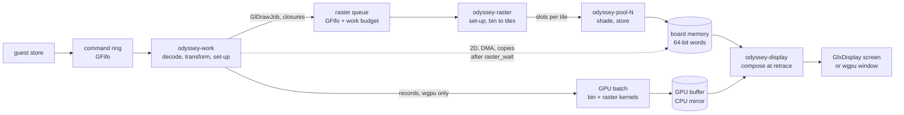
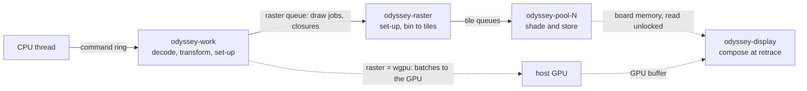

# VPro (Odyssey)

Source: `src/dev/odyssey/`. Part of [Graphics boards](README.md).

VPro is an Octane graphics board. A front-end ASIC does the
geometry, the raster work and the texturing, and a back-end ASIC drives scan-out. The processor stores commands to two FIFO ports. Bulk pixel data moves
by DMA descriptors that walk a page table in guest memory.

## The pipeline

The white paper names two ASICs. The front end, VPro's OpenGL on a Chip (Buzz), does the geometry and the rasterisation. The back end, Pixel Blaster & Jammer, drives the display. The FIFO between them is not publicly documented. In Iris, the model runs geometry on its front-end thread and rasterises on tile workers, or on the host GPU.

```mermaid
flowchart LR
  A["<b>Transform and lighting</b><br/>Hardware: VPro front end (Buzz)<br/>Iris: shared GL core, on odyssey-work"]
  B["<b>Clipping</b><br/>Hardware: VPro front end (Buzz)<br/>Iris: shared GL core, in pipe/setup.rs"]
  C["<b>Set-up</b><br/>Hardware: VPro front end (Buzz)<br/>Iris: odyssey-work builds a GlDrawJob;<br/>odyssey-raster sets the primitive up again<br/>for the pixel stage"]
  D["<b>Rasterisation</b><br/>Hardware: the front end's raster unit (pixel order not documented)<br/>Iris: odyssey-raster bins to screen tiles;<br/>odyssey-pool workers walk them,<br/>or GPU bin and raster kernels"]
  E["<b>Shading and texture</b><br/>Hardware: the front end's raster and texture units<br/>Iris: pool workers, SIMD quad kernels;<br/>or the GPU raster kernel.<br/>Sampling widths approximated"]
  G["<b>Per-fragment operations</b><br/>Hardware: OpenGL 1.2 per-fragment operations<br/>(inferred: stencil, depth, blend, logic op, colour mask)<br/>Iris: same workers, kernels chosen once per draw"]
  H[("<b>Frame buffer</b><br/>Hardware: board SDRAM, shared with textures<br/>and the command FIFO<br/>Iris: one array of 64-bit words, or a GPU buffer<br/>with a CPU mirror")]
  I["<b>Scan-out</b><br/>Hardware: Pixel Blaster & Jammer back end<br/>Iris: odyssey-display composes at retrace"]
  A --> B --> C --> D --> E --> G --> H --> I
```

## Data flow

`odyssey-work` is the front end. It decodes each store (`command.rs`), tracks
state, transforms, lights, clips and sets primitives up (`assembly.rs`,
`geometry.rs`). A GL primitive crosses to the raster unit as a `GlDrawJob`
(`gl.rs`): its raster rules, draw state, vertices, texture chain and the texture
tables it reads. Everything else (a clear, a fence, a query) crosses as a closure
over what it needs. Finished jobs come back on a small return ring so a draw
allocates nothing. The front end waits when the queued work, estimated in pixels,
passes a budget (`RASTER_WORK_BUDGET`), not when a job count is reached.

`odyssey-raster` sets each primitive up again for the pixel stage and writes it
as one slot in a ring (`pipe/ring.rs`): a triangle and its bounding box, a quad it
shaded itself, or a clear's rectangle. The slot's index goes on the queue of each screen tile the command touches. A pool worker (`odyssey-pool-N`; the count is
`[graphics] threads`) takes a ready tile, owns it until its queue is empty, walks each triangle within the tile in 2x2 quads (an Iris choice; the board's pixel order is not documented) and shades and stores each quad. Iris keeps one owner per tile, so pixels stay in order. The stage state is kept as
the board's own register words, grouped by the stage that reads them
(`pipe/state.rs`), and the per-quad kernels are specialised by const generics and
run four pixels at a time on the host's SIMD unit (`pipe/lanes.rs`).

Board memory is one array of 64-bit words, sized once and never moved
(`vram.rs`). A field is a bit range of its word, read by shift and mask, so
nothing byte-swaps. Surfaces over it are named the way the command stream names
them: a base address, a pitch in tiles and a pixel size. The raster unit and the
display reach it through a raw pointer (`VramPtr`) with no lock. The front end's
own memory work (integer drawing, image puts, pixel DMA, copies, reset) first
waits for the raster queue to empty (`Board::raster_wait`), which is the command
stream's order and not a lock.

The display takes a snapshot and composes the whole screen at each retrace, with no dirty tracking (`frame.rs`: `snapshot`
reads the scan-out registers, `compose` walks the pixels, picking a kernel per
run of equal window ID). Lookup tables and modes are atomic words with a
generation. The swap latch and the display FIFO each keep their own lock, because
the hardware's buffer swap is its own synchronisation point.

## 2D drawing

2D drawing runs through `paint_integer` (`odyssey/draw.rs`) on the
odyssey-work front-end thread, after the raster stage has drained. What the
chip does with these commands is not publicly documented.

## Threads

Work passes down the queues in order.

## The texture unit

The texture registers and what a draw latches from them are in `pipe/texture.rs`.
The field layouts are what the GL library writes. What the board does with them is
mostly unknown, so the unit samples by OpenGL's rules: it is approximated, not
measured. The unit reads board memory where the level table points. Sub-texel
positions, filter weights, level-of-detail and component widths are the model's
choices, listed at the top of that file.

## On the host GPU

With `[graphics] raster = "wgpu"` the raster and pool threads do not start. The
front end appends a fixed-size record per primitive to a batch
(`src/dev/odyssey/wgpu/`), with the state it was issued under in a slot. A batch
is two dispatches: a bin pass gives each screen tile a bitmask over the
primitives, and a raster pass runs one workgroup per busy tile, which walks its
mask in order and stores pixels itself. Board memory lives in a GPU buffer.
The CPU `Vram` stays as a mirror for what still runs on the CPU, kept current by
two dirty maps. Swaps do not wait on the GPU: the retrace latches a flip once the
drawing before the arm is submitted.

The kernels are the CPU model's arithmetic again, held to it word for word by
parity tests. That rules out the host's own rasteriser and samplers, and it
costs care: GPU division is not correctly rounded and compilers fuse
multiply-adds, so the kernels divide with `div_exact` and keep products apart
from sums. `clanker/wgpu/gpu-floats-are-not-the-hosts.md` has the rules.

## Monitor commands and tests

`vpro shot` (`odyssey/debug.rs`) takes a screenshot. `odyssey/record.rs`
records command streams. `raster_bench.rs` and `display_bench.rs` are the
benchmarks, and the tests are under `odyssey/tests/`.
